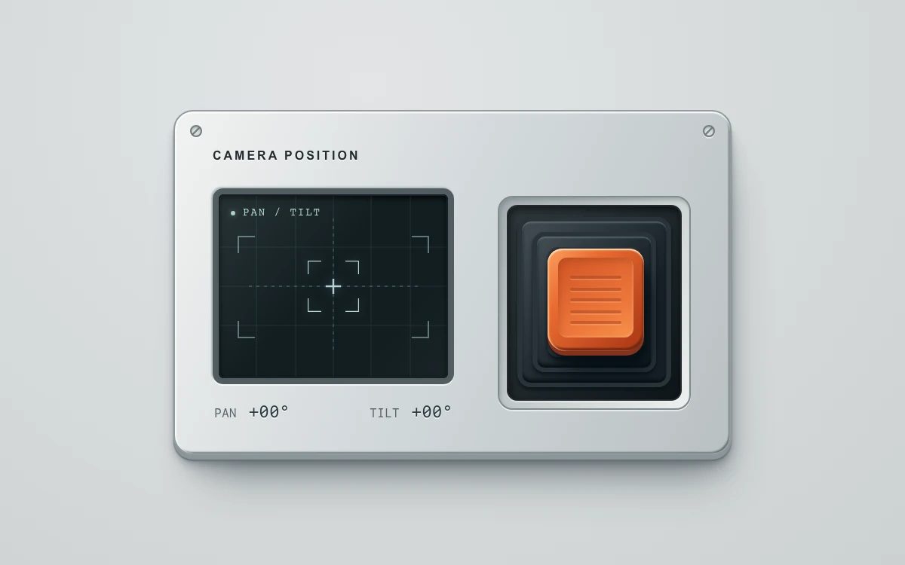

# Gimbal control

> A tactile grip moves a pan-and-tilt viewfinder and returns to neutral on release.

- **Common name:** Spring joystick control
- **Category:** Components & interactions
- **Live demo:** https://www.subframe.com/motion/spring-joystick
- **Source:** Subframe (original, MIT)
- **Dependencies:** none

## Use case

Move a virtual camera target with momentary two-axis input and a clear neutral position.

## Interaction

Drag or hold arrow keys; release to return to center.

## Look

Silver hardware panel with screws, a dark grid viewfinder with crosshair, monospace readouts, and an orange ribbed grip in a stepped black well.

## Motion

Dragging pushes the grip within a circular limit, tilting it in 3D as nested rings and crosshair follow; release eases to centre with 450 ms overshoot; arrow keys move instantly.

## How to adapt

Pointer mapping and the unit-circle clamp are `move` and `limit`; layer travel is in inline transforms (`point.x * 27`, tilt `13` deg, fold scales `[0.13, 0.3, 0.5]`), and the return is `450ms cubic-bezier(.2,1.25,.3,1)`. Wire `point` to your target and replace the viewfinder.

## Reduced motion

No idle animation; reduced motion and keyboard input update immediately.

## Limitations

Position demonstration only; does not control a real camera. 

## Taxonomy

- **Components:** slider
- **Triggers:** drag, keyboard
- **Techniques:** spring, 3d, parallax
- **Feel:** technical, playful
- **Contexts:** app
- **Tags:** joystick, gimbal, pan and tilt, pointer capture, momentary input, spring return, tactile UI
- **Also known as:** virtual joystick, XY pad, thumbstick control, pan and tilt pad, skeuomorphic joystick
- **Surface color:** `#d5dadc`

## Code

See [`component.tsx`](component.tsx).
