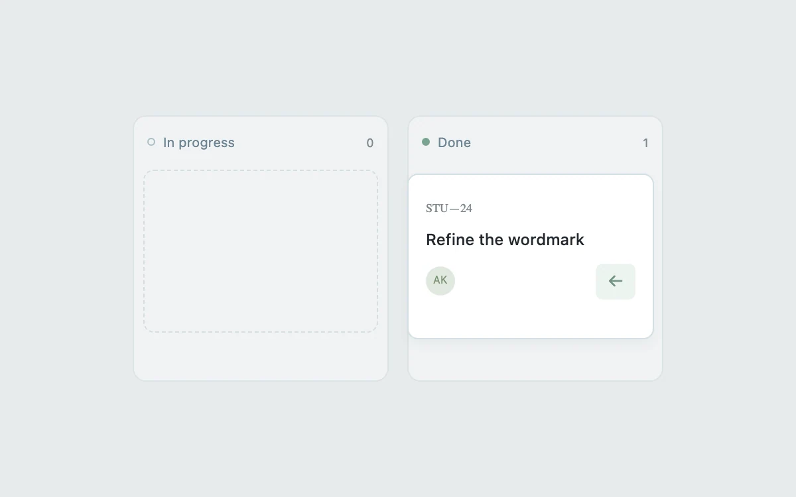

# Status transfer

> Move a task between workflow stages with immediate spatial feedback.

- **Common name:** Kanban drag and drop
- **Category:** Components & interactions
- **Live demo:** https://www.subframe.com/motion/status-board
- **Source:** Subframe (original, MIT)
- **Dependencies:** none

## Use case

Move a task between workflow stages with immediate spatial feedback.

## Interaction

Move the task between columns

## Look

Light blue-grey page with two pale rounded columns: a dashed empty slot in one, a white task card with initials avatar in the other.

## Motion

Dragging the card to the other column, or pressing its check or arrow button, slides it across with a 250 ms ease-out translate; it dims to half opacity while dragged.

## How to adapt

The move is a `transform 250ms cubic-bezier(0.2, 0.8, 0.2, 1)` transition on `.task`, toggled by `done` from native `onDrop` or the button; `translateX(calc(100% + 14px))` assumes two columns. Replace the task and columns with real data; keep the button for keyboard and touch.

## Reduced motion

Live system preference disables decorative motion; all controls remain usable. Keyboard actions settle immediately.

## Limitations

One isolated task and two stages. Native desktop drag plus a keyboard/touch move button; no workflow persistence.

## Taxonomy

- **Components:** list, card
- **Triggers:** drag, press
- **Techniques:** slide, fade
- **Feel:** subtle
- **Contexts:** app, dashboard
- **Tags:** kanban, transfer, drag, status, task
- **Also known as:** kanban board, drag card between columns, task status change, move to done
- **Surface color:** `#edf0f3`

## Code

See [`component.tsx`](component.tsx).
