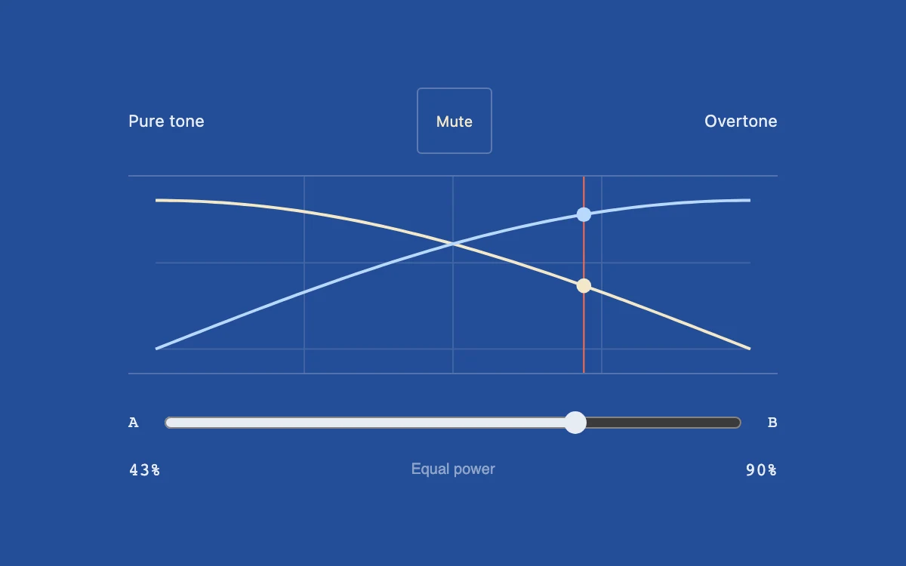

# Stereo blend

> Two synthesized timbres blend through complementary gain curves drawn on a blue instrument surface.

- **Common name:** Audio crossfade control
- **Category:** Components & interactions
- **Live demo:** https://www.subframe.com/motion/stereo-blend
- **Source:** Subframe (original, MIT)
- **Dependencies:** none

## Use case

Compare or combine timbres without the center level collapsing.

## Interaction

Enable sound and move the equal-power blend control.

## Look

Saturated cobalt-blue panel with a thin white grid, crossing cream and pale-blue gain curves, a red vertical marker, a range slider and monospace percentages.

## Motion

Dragging the blend slider moves a red marker and two dots along cosine and sine gain curves directly, while oscillator gains glide with a 25 ms time constant.

## How to adapt

Gains follow `Math.cos`/`Math.sin` of `blend` (scaled by 0.045) and ramp via `setTargetAtTime` with a 0.025 s constant; the SVG curves, marker and dots derive from the same `blend`. Swap the two `createOscillator` tones (220 and 330 Hz) for real audio sources.

## Reduced motion

Gain changes retain short audio ramps that prevent clicks; the diagram redraws directly.

## Limitations

Two local oscillators, not uploaded tracks. Equal-power gain law does not guarantee equal perceived loudness for all timbres.

## Taxonomy

- **Components:** slider, media, chart
- **Triggers:** drag, state
- **Techniques:** path
- **Feel:** technical
- **Contexts:** app
- **Tags:** audio, crossfade, equal-power, gain, synthesizer, curve
- **Also known as:** DJ crossfader, equal-power crossfade, mix balance slider, gain curve visualizer
- **Surface color:** `#244d97`

## Code

See [`component.tsx`](component.tsx).
