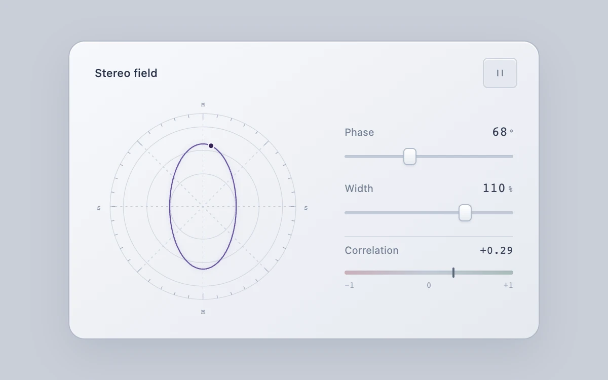

# Stereo field

> A stereo vector plot connects phase and width controls to a continuous trace and correlation meter.

- **Common name:** Audio vectorscope
- **Category:** Animation & motion
- **Live demo:** https://www.subframe.com/motion/stereo-field
- **Source:** Subframe (original, MIT)
- **Dependencies:** none

## Use case

Make mid/side stereo relationships visible in an audio control or signal-inspection tool.

## Interaction

Adjust phase and width, inspect correlation, and pause or resume the trace.

## Look

Pale blue-grey instrument card: a circular scope of rings, ticks and dashed axes with a violet ellipse, beside two sliders, monospace readouts and a meter.

## Motion

A dark dot travels the violet Lissajous trace continuously (about 3.8 s per lap); phase and width sliders reshape the ellipse and move the correlation needle instantly.

## How to adapt

`signalPath` builds the trace from `phase` and `width`, `correlation` drives the meter, and the `tick` loop moves the `dot` at the `1.65` rate. Feed real left/right samples into `signalPath` instead of the synthetic `Math.sin` pair.

## Reduced motion

The phase relationship remains visible as a static vector plot; controls still update the shape and correlation immediately.

## Limitations

Synthetic two-channel sine signal only, with no audio capture or playback. Correlation describes the generated signal, not a connected audio source; a silent mid/side result reads zero.

## Taxonomy

- **Components:** media, chart, slider
- **Triggers:** ambient, state
- **Techniques:** path, morph, loop
- **Feel:** technical, refined
- **Contexts:** app, dashboard
- **Tags:** audio, vectorscope, phase, mid-side, correlation, signal, svg
- **Also known as:** stereo phase meter, goniometer, lissajous plot, audio phase scope, stereo width meter
- **Surface color:** `#c9ced8`

## Code

See [`component.tsx`](component.tsx).
