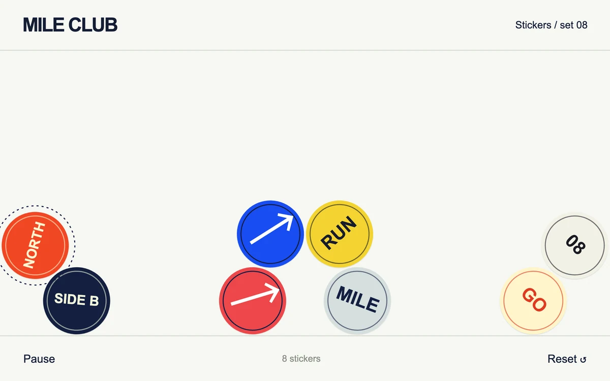

# Sticker gravity

> Eight graphic club seals tumble into a shallow tray and collide as individual draggable bodies.

- **Common name:** Draggable physics stickers
- **Category:** Animation & motion
- **Live demo:** https://www.subframe.com/motion/sticker-gravity
- **Source:** Subframe (original, MIT)
- **Dependencies:** none

## Use case

Turn a small set of circular badges into a playful physical arrangement.

## Interaction

Drag and release a seal, or pause and arrange it with the keyboard.

## Look

Off-white sheet between header and footer rules, with eight flat circular stickers in orange, cobalt, yellow, navy, red, grey and cream piled on the floor.

## Motion

On load the stickers drop under gravity at a fixed 120 Hz step, bouncing, spinning and colliding until they settle; dragging and releasing throws a sticker with its pointer velocity.

## How to adapt

Physics lives in `solve` (gravity 590, wall and floor restitution 0.62 and 0.47, collision factor 1.45), stepped at 1/120 s by `tick`; `draw` paints the canvas. Replace the `marks` colour and label triples; keep the `settledFrames` idle stop and pointer capture.

## Reduced motion

The simulation begins paused; badges can still be placed directly with pointer or keyboard controls.

## Limitations

Eight bounded circular bodies with a fixed-step impulse solver. This is intentionally not general polygon physics.

## Taxonomy

- **Components:** scene
- **Triggers:** drag, enter, keyboard
- **Techniques:** physics, canvas, rotate
- **Feel:** playful
- **Contexts:** landing, editorial
- **Tags:** physics, collision, drag, fixed timestep, canvas
- **Also known as:** throwable badges, falling sticker pile, gravity toy, collision physics playground
- **Surface color:** `#ecebe7`

## Code

See [`component.tsx`](component.tsx).
