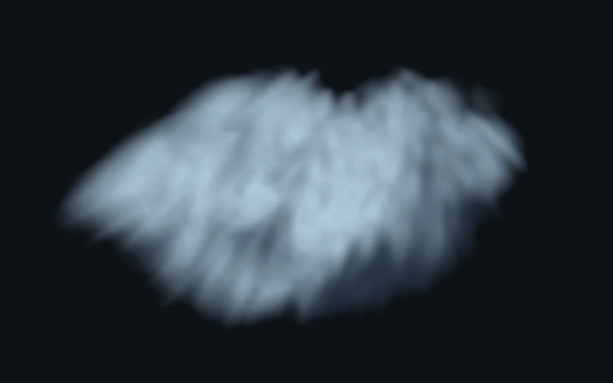

# Storm volume

> A dense cloud turns slowly beneath a cold silver rim.

- **Common name:** Volumetric cloud shader
- **Category:** WebGL & shaders
- **Live demo:** https://www.subframe.com/motion/storm-volume
- **Source:** Subframe (original, MIT)
- **Dependencies:** none

## Use case

A focused atmospheric object for climate, film, and immersive storytelling.

## Interaction

Adjust density

## Look

A soft, wispy pale blue-grey cloud mass floating on a near-black slate-blue field, lit from the upper left with silvery highlights.

## Motion

The noise inside the raymarched cloud drifts slowly sideways, so its wisps churn and the mass appears to turn; a density slider thickens or thins it live.

## How to adapt

The cloud is the `FRAGMENT` raymarcher: `volume` shapes it (`envelope` plus `layered` noise, drifting with `u_time*.045`), 36 steps accumulate light and `u_control` scales absorption. Tune those and the `light` colours; keep the fallback and reduced-motion still frame.

## Reduced motion

A representative frame remains still. Live system preference changes immediately stop the loop; the range control continues to update the still image.

## Limitations

Requires WebGL 1. A static CSS fallback appears when unavailable or after context loss. 36 density samples per pixel at a capped render resolution; illustrative lighting without multiple scattering.

## Taxonomy

- **Components:** scene, background
- **Triggers:** ambient
- **Techniques:** shader, noise, 3d
- **Feel:** calm
- **Contexts:** landing, editorial
- **Tags:** volumetric, cloud, raymarching, atmosphere, smoke, native webgl
- **Also known as:** raymarched cloud, smoke shader, volumetric fog, 3D cloud background
- **Surface color:** `#101820`

## Code

See [`component.tsx`](component.tsx).
