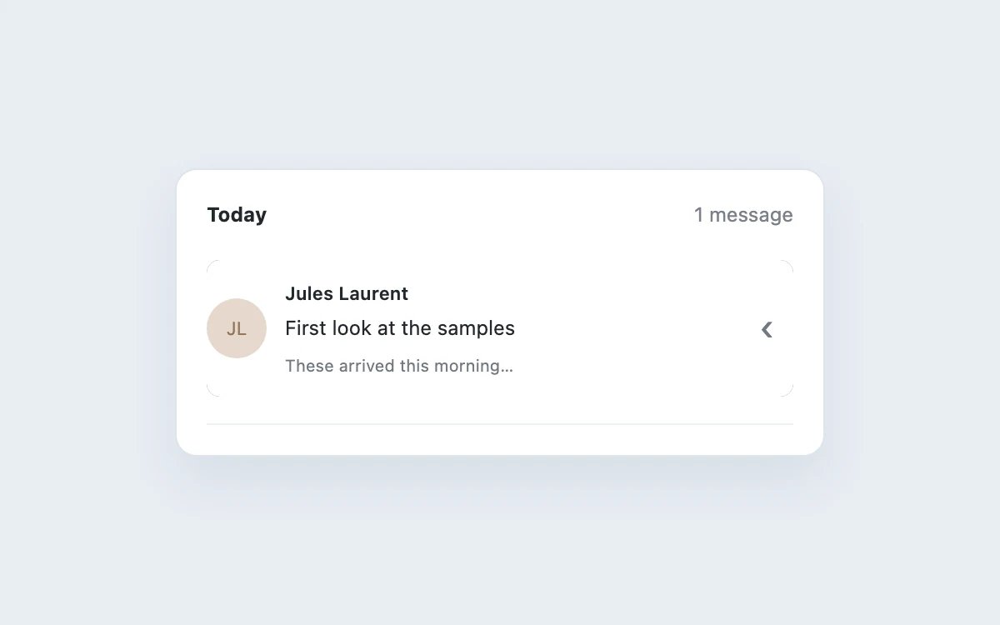

# Swipe to archive

> Expose a destructive or secondary action through a deliberate horizontal gesture.

- **Common name:** Swipe-to-archive list item
- **Category:** Components & interactions
- **Live demo:** https://www.subframe.com/motion/swipe-actions
- **Source:** Subframe (original, MIT)
- **Dependencies:** none

## Use case

Expose a destructive or secondary action through a deliberate horizontal gesture.

## Interaction

Reveal message actions

## Look

Pale blue-grey page with a white rounded inbox card holding one message row with a beige initials avatar, grey preview text and chevron.

## Motion

Dragging the row left reveals a green archive action; release snaps it open at 64 px or closed, and past 75 px it slides off and fades (220 ms ease-out).

## How to adapt

Gesture logic is in the `mail-row` pointer handlers (-100 clamp, -75 archive and -30 snap thresholds, -64 open offset); settling is its 220 ms transition. Replace the sender and subject, wire `setArchived` to a real action, and keep the reveal and Undo buttons.

## Reduced motion

Live system preference disables decorative motion; all controls remain usable. Keyboard actions settle immediately.

## Limitations

Local archive state. A reveal button and archive button provide a complete keyboard alternative.

## Taxonomy

- **Components:** list
- **Triggers:** drag, press
- **Techniques:** slide, fade
- **Feel:** subtle
- **Contexts:** app
- **Tags:** swipe, archive, gesture, undo, inbox
- **Also known as:** swipe to delete, swipeable list row, email swipe gesture, slide to reveal action
- **Surface color:** `#edf0f3`

## Code

See [`component.tsx`](component.tsx).
