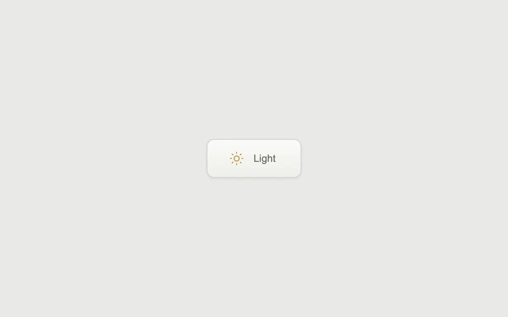

# Change the light

> A turning sun, a crossfade and a passing highlight make a theme change feel considered.

- **Common name:** Theme toggle button
- **Category:** Components & interactions
- **Live demo:** https://www.subframe.com/motion/switch-button
- **Source:** Kokonut UI (adapted, MIT) — https://kokonutui.com/docs/components/switch-button · [original code](https://github.com/kokonut-labs/kokonutui/blob/83eec6d982d400a18438001a8efdbac1f159dd43/components/kokonutui/switch-button.tsx)
- **Dependencies:** none

## Use case

Connect the light and dark states of an appearance control.

## Interaction

Toggle the example's appearance

## Look

A single off-white rounded button with a soft top-to-bottom gradient, a gold outline sun icon and a grey label, centred on pale grey.

## Motion

Hover spins the sun 360° (700 ms) and sweeps a highlight across (500 ms); toggling crossfades the label and page colour over 250 ms and turns the sun 180°.

## How to adapt

All motion is CSS in the inline style block: `.sf-theme-sun` rotation with `cubic-bezier(.645,.045,.355,1)`, the `.sf-theme-label` crossfade and `.sf-theme-shine` sweep, keyed off `data-dark`. Replace the local `dark` state with your app's appearance setting.

## Reduced motion

The labels and colors still change; icon rotation and the moving highlight are removed.

## Limitations

The theme change is scoped to this preview. Connect its local state to your application's appearance setting.

## Taxonomy

- **Components:** toggle, button
- **Triggers:** press, hover, state
- **Techniques:** rotate, fade, glow
- **Feel:** subtle, refined
- **Contexts:** app
- **Tags:** button, theme, toggle, click, hover, sun, rotation, shine, CSS
- **Also known as:** dark mode toggle, light dark switch, appearance toggle, day night button
- **Surface color:** `#e9e9e7`

## Code

See [`component.tsx`](component.tsx).
