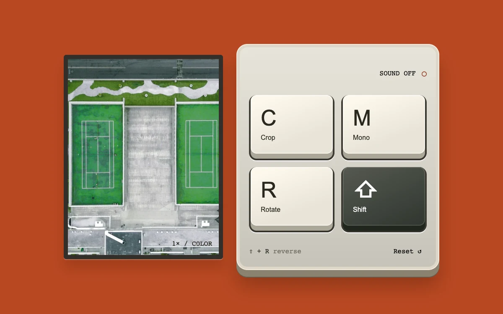

# Tactile keypad

> Four physical keys crop, desaturate and rotate an aerial court photograph; Shift reverses the rotation.

- **Common name:** Tactile keyboard keys
- **Category:** Components & interactions
- **Live demo:** https://www.subframe.com/motion/tactile-keypad
- **Source:** Subframe (original, MIT)
- **Dependencies:** none

## Use case

Make infrequent creative shortcuts discoverable through a small, functioning material control.

## Interaction

Press C, M and R or the keycaps. Hold Shift with R to rotate backward. Enable sound explicitly if desired.

## Look

Burnt-orange background with an aerial tennis-court photo in a dark bezel beside a cream plastic keypad of four chunky keys, one charcoal.

## Motion

Clicking a keycap or pressing C, M or R sinks it 5 px with a collapsing side shadow; release lifts it in 80 ms ease-out; photo edits are instant.

## How to adapt

Key travel is the `tk-key` `data-down` CSS rule (5 px drop, shadow collapse, 80 ms ease-out release), set by `press` and `release`; `clickSound` is optional Web Audio. Replace `KEYS`, the tennis-court image and the `crop`, `mono` and `turn` edits.

## Reduced motion

Keys change depth immediately; image edits do not animate.

## Limitations

Local image transformations only. Optional switch sound is synthesized with Web Audio after explicit opt-in.

## Taxonomy

- **Components:** button, image
- **Triggers:** press, keyboard
- **Techniques:** slide
- **Feel:** playful, technical
- **Contexts:** app, landing
- **Tags:** keypad, keyboard, chord, material, press, audio, image-editing
- **Also known as:** mechanical keycaps, skeuomorphic key press, keyboard shortcut pad, macro pad
- **Surface color:** `#b94822`

## Assets

- [`tennis-court.webp`](../../assets/tennis-court.webp) — Two green tennis courts seen from above (Unsplash)

## Code

See [`component.tsx`](component.tsx).
