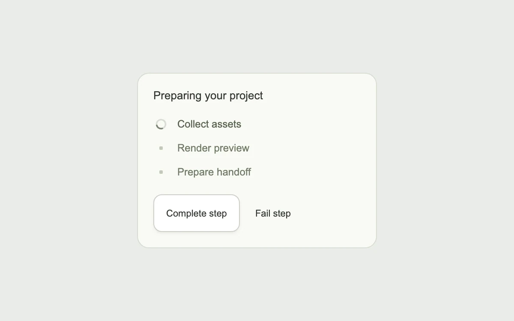

# Progress, step by step

> An active step becomes a settled check while the next task takes its turn.

- **Common name:** Step progress checklist
- **Category:** Components & interactions
- **Live demo:** https://www.subframe.com/motion/task-steps
- **Source:** Interior (adapted, MIT) — https://www.interior.dev/docs/task-steps · [original code](https://github.com/ddoemonn/interior/blob/314800833bf01e23e6ae74c2a17fbdaac3688c84/components/interior/task-steps.tsx)
- **Dependencies:** motion@12.0.5

## Use case

Explain a multi-stage upload, export or preparation task with progress that has meaning.

## Interaction

Complete a step, or try a failure

## Look

Pale sage-grey page with an off-white rounded card: three muted green-grey step rows with a thin spinner or tiny dots, and two small buttons.

## Motion

Completing a step springs a green tick in from 0.8 scale and fade while the next row's spinner begins a 0.8 s linear spin; failure swaps in a red cross.

## How to adapt

Status comes from `useTaskSteps` (drive `current` and `failed` from real work); icons swap in `AnimatePresence` keyed by `row.status`, with the `POP` spring for done, `CELL` otherwise and `Arc` as the spinner. Replace `DEMO_STEPS` and the manual buttons.

## Reduced motion

State indicators change immediately; spinning and scale transitions are disabled.

## Limitations

The preview advances manually. Wire current and failed to real progress rather than a cosmetic timer.

## Taxonomy

- **Components:** progress, list
- **Triggers:** state, loading
- **Techniques:** spring, scale, rotate, fade
- **Feel:** subtle
- **Contexts:** app
- **Tags:** progress, steps, task, loading, spinner, checkmark, success, error, click
- **Also known as:** multi-step loader, task progress list, step status indicator, pipeline status list
- **Surface color:** `#eaece8`

## Code

See [`component.tsx`](component.tsx).
