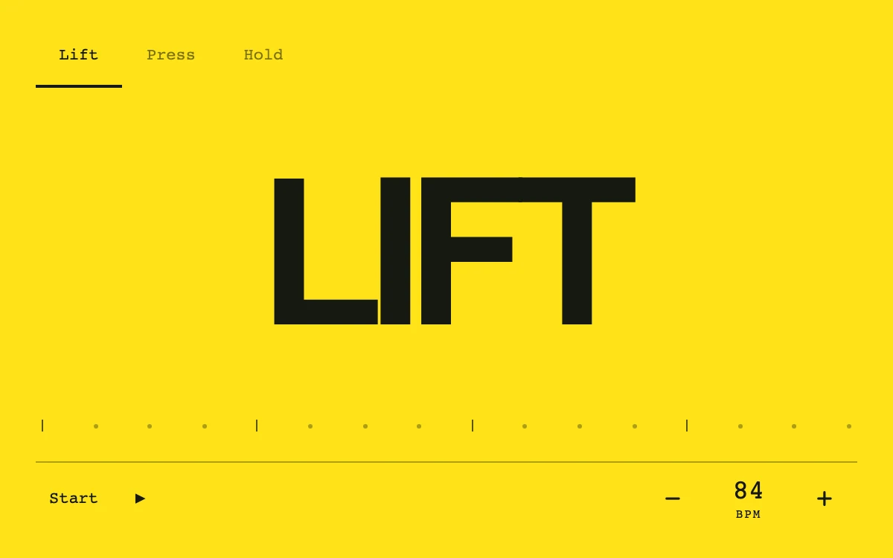

# Tempo type

> A yellow type specimen lifts, compresses or holds to an adjustable sixteen-beat cadence.

- **Common name:** Kinetic typography
- **Category:** Animation & motion
- **Live demo:** https://www.subframe.com/motion/tempo-type
- **Source:** Subframe (original, MIT)
- **Dependencies:** none

## Use case

Visual rehearsal of rhythmic motion through typography.

## Interaction

Choose a pattern, start, and change BPM.

## Look

Saturated yellow field with one huge heavy black tightly tracked sans-serif word, monospace mode tabs, a sixteen-step beat rail and a tempo stepper.

## Motion

Once started, a 40–160 BPM clock pulses the word each beat with a decaying envelope (tall stretch, wide squash or dim, per mode) as a dot steps through sixteen ticks.

## How to adapt

The beat loop is `draw`: `beats` advances from `bpm`, `envelope` decays quadratically over the first `0.57` of each beat, and `mode` maps it to a non-uniform scale (`0.23`, `0.22`) or opacity. Replace `modes`, which also supplies the displayed word.

## Reduced motion

Typography and beat position stay still; mode and tempo controls remain available.

## Limitations

A visual 40–160 BPM clock, not sample-accurate audio playback.

## Taxonomy

- **Components:** text
- **Triggers:** ambient, press
- **Techniques:** scale, loop
- **Feel:** bold, playful
- **Contexts:** landing, editorial
- **Tags:** kinetic-type, tempo, beat, rhythm, squash, stretch, metronome
- **Also known as:** beat-synced text, squash and stretch type, metronome text pulse, rhythmic headline
- **Surface color:** `#ffe319`

## Code

See [`component.tsx`](component.tsx).
