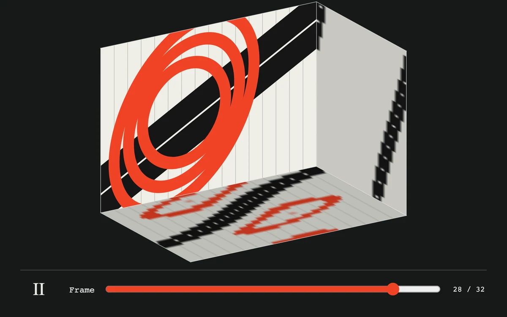

# Temporal volume

> An orbitable volume exposes a moving frame and the history along its edges.

- **Common name:** Video time volume
- **Category:** Animation & motion
- **Live demo:** https://www.subframe.com/motion/temporal-volume
- **Source:** Subframe (original, MIT)
- **Dependencies:** none

## Use case

Compare motion across time without losing the current frame.

## Interaction

Orbit, play or scrub.

## Look

Near-black stage with an off-white 3D box showing red ellipses and a black bar in front, pixel-history smears on its sides, and an orange scrubber.

## Motion

Play steps a 32-frame loop at 16 fps on the front face while the sides rebuild from edge-pixel history; dragging or arrow keys orbit the box; a slider scrubs.

## How to adapt

`paintFrame` draws each procedural frame and `render` projects the six faces with `project`, sampling edge pixels into `side` and `top`; `orbit` clamps yaw and pitch, and `tick` advances every `62.5` ms. Replace `paintFrame` and the `frames` canvases with decoded video frames.

## Reduced motion

Playback stops; direct orbit and frame selection remain available.

## Limitations

Thirty-two original procedural frames at 16 fps. Orthographic Canvas 2D projections and edge samples, not a video decoder or volumetric renderer.

## Taxonomy

- **Components:** media, scene, editor
- **Triggers:** drag, press, keyboard
- **Techniques:** canvas, 3d, loop
- **Feel:** technical, bold
- **Contexts:** editorial, app
- **Tags:** canvas 2d, temporal volume, frame history, scrub, orbit, time
- **Also known as:** video cube, slit-scan visualization, space-time cube, frame history 3D, 3D video scrubber
- **Surface color:** `#161919`

## Code

See [`component.tsx`](component.tsx).
