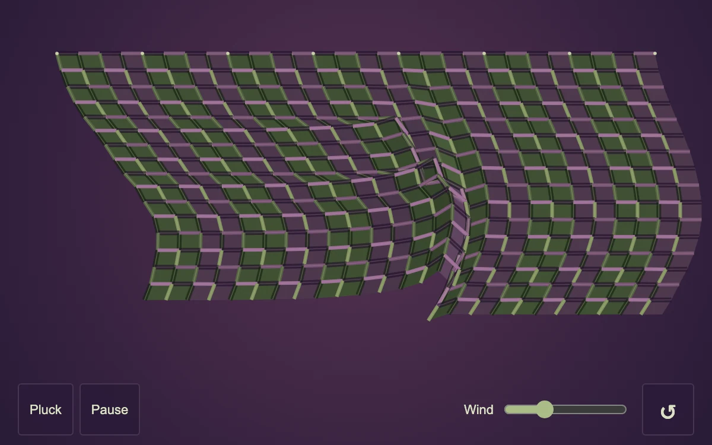

# Tension fabric

> Plum and green threads hang from a pinned edge and pull against their neighbors.

- **Common name:** Cloth physics simulation
- **Category:** Animation & motion
- **Live demo:** https://www.subframe.com/motion/tension-fabric
- **Source:** Subframe (original, MIT)
- **Dependencies:** none

## Use case

Interactive woven materials, cloth studies and responsive mesh surfaces.

## Interaction

Drag a thread, pluck the cloth, adjust wind, or pause

## Look

Dark plum field with a hanging checkered weave of olive-green and mauve threads pinned along its top edge, with outlined buttons and a slider below.

## Motion

A Verlet cloth pinned at its top row sags under gravity and sways in sine wind; dragging pulls the nearest thread, and the pluck button kicks the middle up-right.

## How to adapt

The solver is `step` (Verlet integration, six constraint passes) and `draw` paints the weave; tune `cols`, `rows`, gravity `0.055`, damping `0.965` and the `wind` ref; `action` handles pluck and reset. Recolour the plum and green fills in `draw`.

## Reduced motion

Continuous simulation stops. Pluck and direct manipulation produce static changes.

## Limitations

A bounded 2D position-constraint solver; no 3D collisions, tearing, textile texture asset, or export.

## Taxonomy

- **Components:** scene
- **Triggers:** drag, ambient, press
- **Techniques:** physics, canvas
- **Feel:** playful
- **Contexts:** editorial, landing
- **Tags:** canvas, cloth, verlet, constraints, weave, fabric, physics, drag
- **Also known as:** verlet cloth, draggable fabric, hanging cloth, woven mesh physics, fabric in wind
- **Surface color:** `#291b37`

## Code

See [`component.tsx`](component.tsx).
