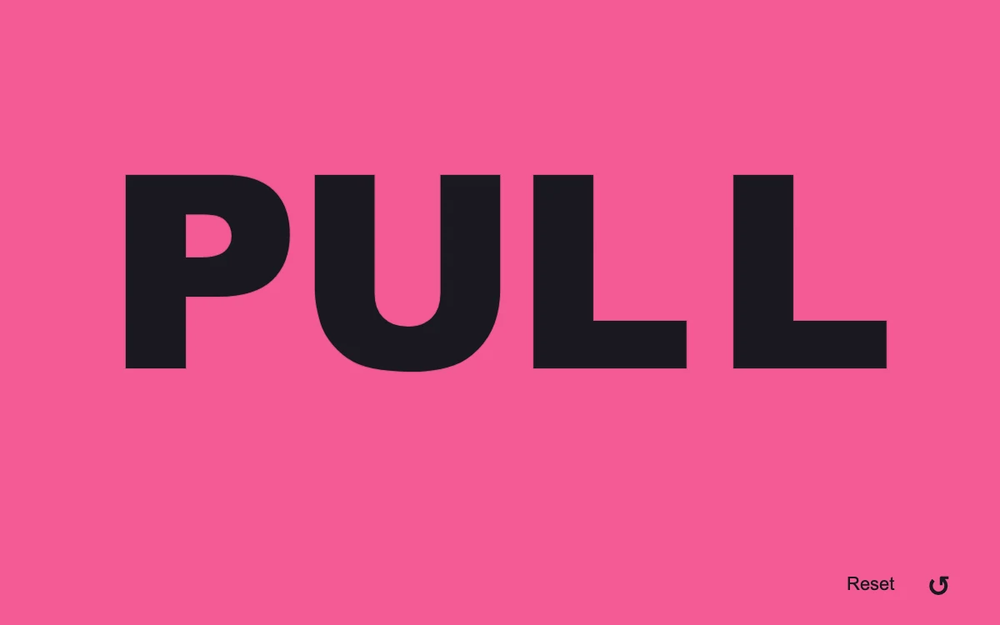

# Tethered type

> Individual letters stretch away from their outline and spring back along a fine elastic tether.

- **Common name:** Elastic draggable letters
- **Category:** Animation & motion
- **Live demo:** https://www.subframe.com/motion/tethered-type
- **Source:** Subframe (original, MIT)
- **Dependencies:** none

## Use case

Turn a short wordmark or type specimen into a tactile, direct-manipulation object.

## Interaction

Drag a letter and release it, or use arrow keys and Enter

## Look

Hot-pink full-bleed field with four huge black extra-bold sans-serif capitals spanning the width and a small reset control in the corner.

## Motion

Dragging a letter pulls it off a faint outline while a thin curved tether stretches from its origin; release springs it back with slight overshoot (stiffness 340, damping 23).

## How to adapt

The return spring is integrated in `tick` (`-340 * g.x - 23 * g.vx`), `place` clamps drags and `paint` writes each glyph `transform` and tether `d`. Replace `letters`, then update `center` and the inline `left` percentages for another word length.

## Reduced motion

Direct dragging and keyboard positioning remain available; release returns the letter immediately without oscillation.

## Limitations

A four-letter specimen with bounded displacement. Resize, host pause and document hiding reset all letters. It is not a text editor or font shaper.

## Taxonomy

- **Components:** text
- **Triggers:** drag, keyboard
- **Techniques:** spring, split-text, path
- **Feel:** playful, bold
- **Contexts:** landing, editorial
- **Tags:** typography, drag, spring, tether, letters, elastic, wordmark, pointer capture
- **Also known as:** rubber band letters, spring back wordmark, pull and release text, interactive type specimen
- **Surface color:** `#f45b96`

## Code

See [`component.tsx`](component.tsx).
