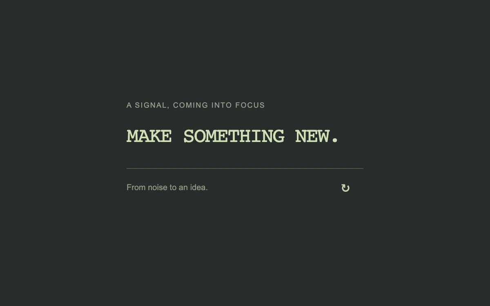

# A signal in the noise

> Random letters settle into a short, readable line from left to right.

- **Common name:** Text scramble effect
- **Category:** Animation & motion
- **Live demo:** https://www.subframe.com/motion/text-scramble
- **Source:** Motion Primitives (adapted, MIT) — https://motion-primitives.com/docs/text-scramble · [original code](https://github.com/ibelick/motion-primitives/blob/120f64f6ca60348e251f929e9c81f11ccbe45eda/components/core/text-scramble.tsx)
- **Dependencies:** none

## Use case

Introduce a brief technical or editorial headline. Keep essential reading outside the scramble.

## Interaction

Replay the text scramble

## Look

Dark charcoal-green field with a pale lime monospace uppercase headline, a small letterspaced grey-green eyebrow, a thin rule, caption and replay glyph.

## Motion

On mount or replay, each letter shows random A–Z/0–9 characters every 40 ms and locks to its final glyph left to right over 20 steps (about 0.8 s).

## How to adapt

The scramble is the `setInterval` effect: `steps` (20) and the 40 ms interval set duration, `characters` is the random pool, and a letter resolves once `progress * text.length > index`. Replace `text`; keep the `aria-label` and reduced-motion branch.

## Reduced motion

The final text stays visible, with no changing random characters.

## Limitations

The supplied uppercase Latin character set suits this English phrase. Choose a script-appropriate set for other languages.

## Taxonomy

- **Components:** text
- **Triggers:** enter, press
- **Techniques:** split-text
- **Feel:** technical
- **Contexts:** landing, editorial
- **Tags:** text, scramble, decode, random letters, headline, replay, entrance
- **Also known as:** decode text effect, hacker text animation, random character reveal, decrypt text animation, shuffle letters headline
- **Surface color:** `#272d2a`

## Code

See [`component.tsx`](component.tsx).
