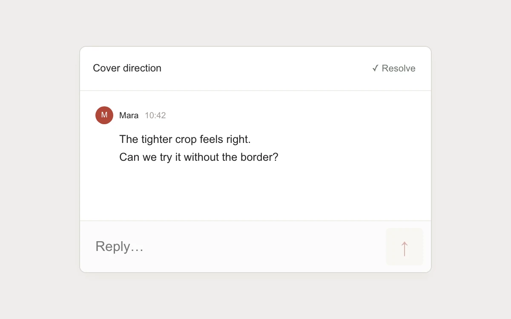

# Thread reply

> A typed reply becomes part of a compact review thread without moving the composer.

- **Common name:** Comment thread reply
- **Category:** Components & interactions
- **Live demo:** https://www.subframe.com/motion/thread-reply
- **Source:** Subframe (original, MIT)
- **Dependencies:** none

## Use case

Continue a contextual review while keeping the conversation and input connected.

## Interaction

Write a reply, send with Enter, then resolve or reopen the thread.

## Look

Warm light-grey page with a white comment panel holding one comment with a brick-red initial avatar and a pale composer with an up-arrow send button.

## Motion

A clicked send appends the reply with a 200 ms ease-out fade and 5 px rise and jumps the log to the bottom; keyboard sends appear instantly.

## How to adapt

`send` appends to `replies` and the effect pins `scroll` to the bottom; the entrance is the `reply-w2` keyframes on `.reply`, skipped by `usePreview` after keyboard input. Replace the seeded comment, names and three-reply cap with real thread data.

## Reduced motion

Replies appear immediately; focus and conversation scrolling remain direct.

## Limitations

Local thread with three replies per preview; no messaging, persistence or server delivery.

## Taxonomy

- **Components:** list, input
- **Triggers:** enter, press, keyboard
- **Techniques:** fade, slide
- **Feel:** subtle
- **Contexts:** app
- **Tags:** thread, comment, reply, composer, submit, focus, resolve, discussion
- **Also known as:** reply composer, review comments panel, chat message list, discussion thread
- **Surface color:** `#efeeeb`

## Code

See [`component.tsx`](component.tsx).
