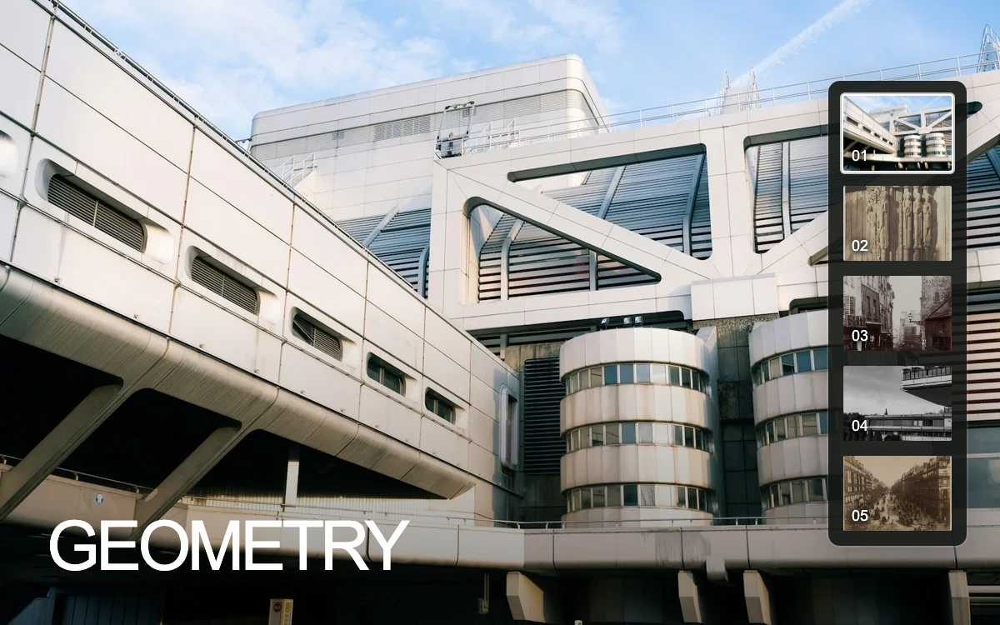

# Thumbnail index

> A visible five-image dock selects full-frame architectural photographs with a precise white selection edge.

- **Common name:** Thumbnail image gallery
- **Category:** Components & interactions
- **Live demo:** https://www.subframe.com/motion/thumbnail-index
- **Source:** Subframe (original, MIT)
- **Dependencies:** none

## Use case

Browse a short visual sequence while seeing every available image and the current selection.

## Interaction

Choose a thumbnail. Up, Down, Home and End move the focused selection.

## Look

Full-bleed architectural photograph with a large white sans caption bottom-left and a dark rounded vertical rail of five numbered thumbnails, the selected one white-framed.

## Motion

Choosing a thumbnail crossfades the full image over 260 ms while it settles from 1.025 to 1 scale with a 420 ms ease-out; keyboard selection switches instantly.

## How to adapt

Each `archive` image is stacked as a `.ti-image` whose opacity and `scale` follow `current` through CSS transitions (260 ms fade, 420 ms `cubic-bezier(.22,1,.36,1)`); `choose` handles selection. Replace `archive` with your images and labels; keep the roving `tabIndex`.

## Reduced motion

Images switch immediately for reduced motion and keyboard selection; host pause disables the thumbnail buttons.

## Limitations

The five-image collection intentionally fits without internal scrolling. Longer collections need an explicit scroll or paging strategy. Image rights are separate from the original code.

## Taxonomy

- **Components:** gallery, image
- **Triggers:** press, keyboard
- **Techniques:** fade, scale
- **Feel:** refined, subtle
- **Contexts:** editorial, landing
- **Tags:** thumbnail, index, image selection, image gallery, roving focus, crossfade, navigation
- **Also known as:** thumbnail strip, crossfade slideshow, photo viewer with thumbnails, vertical thumbnail rail
- **Surface color:** `#242820`

## Assets

- [`cathedral-columns.webp`](../../assets/cathedral-columns.webp) — Chartres Cathedral, West Facade; Royal Portal, Central Bay (CC0-1.0)
- [`concrete-geometries.webp`](../../assets/concrete-geometries.webp) — Modern brutalist architecture with geometric shapes (Unsplash)
- [`concrete-projections.webp`](../../assets/concrete-projections.webp) — Brutalist concrete office building (Unsplash)
- [`montmartre.webp`](../../assets/montmartre.webp) — Montmartre (CC0-1.0)
- [`paris-street.webp`](../../assets/paris-street.webp) — Rue de la Montagne-Sainte-Geneviève near the Intersection of Rue LaPlace (Rue de la Montagne-Sainte-Geneviève prés de carrefour de la rue LaPlace) (CC0-1.0)

## Code

See [`component.tsx`](component.tsx).
