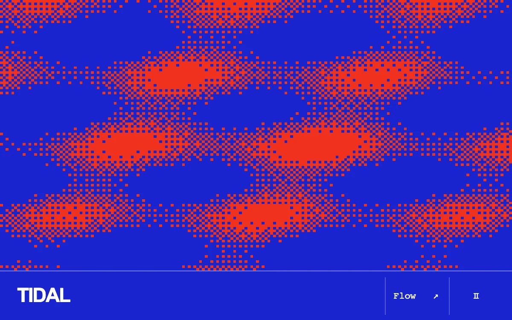

# Tidal bitmap

> Two saturated inks form a pixel field that bends around the pointer and switches into a fractured signal.

- **Common name:** Interactive dither effect
- **Category:** Animation & motion
- **Live demo:** https://www.subframe.com/motion/tidal-bitmap
- **Source:** Subframe (original, MIT)
- **Dependencies:** none

## Use case

Interactive binary texture for an expressive visual surface.

## Interaction

Move the pointer or arrow keys; change the field mode.

## Look

Cobalt-blue field of chunky red pixels forming dithered interference blobs in a diagonal lattice, above a blue footer with white wordmark and monospace controls.

## Motion

Two sine waves drift through a 4×4 Bayer-dithered blue field whose red ink swells around the pointer; a mode toggle switches to blocky cells split at the pointer's height.

## How to adapt

`draw` computes each pixel's `field` (two sine terms minus `dist * 2.2` for pointer falloff) and compares it to the 4×4 Bayer `threshold`; the canvas renders at a third of CSS size, capped at 180×120. Swap the RGB values for your two inks.

## Reduced motion

The field freezes; pointer and mode controls update a single static frame.

## Limitations

Canvas 2D ordered dithering, not WebGL or a physical wave simulation.

## Taxonomy

- **Components:** background, cursor
- **Triggers:** pointer, ambient
- **Techniques:** canvas, noise
- **Feel:** bold, technical
- **Contexts:** landing, editorial
- **Tags:** canvas, bitmap, dither, interference, pointer, two-ink, generative
- **Also known as:** pixel dither background, Bayer dithering, bitmap pattern, two-tone pixel field
- **Surface color:** `#1925cd`

## Code

See [`component.tsx`](component.tsx).
