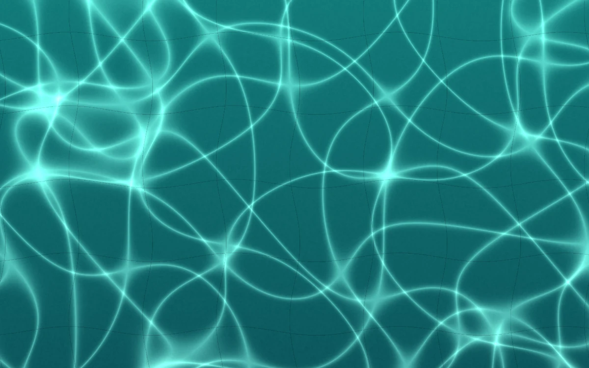

# Tidal caustics

> Sunlit turquoise water casts a drifting lattice on pale pool tiles.

- **Common name:** Water caustics shader
- **Category:** WebGL & shaders
- **Live demo:** https://www.subframe.com/motion/tidal-caustics
- **Source:** Subframe (original, MIT)
- **Dependencies:** none

## Use case

Bring a sense of water and light to hospitality, swimwear, and aquatic identities.

## Interaction

Adjust depth

## Look

Deep teal water filling the frame, crossed by glowing mint-cyan caustic light lines over faint dark pool-tile grid seams.

## Motion

A WebGL fragment shader slowly drifts three warped sine layers into a shifting caustic lattice while tile seams wobble; the Depth slider brightens the light and a button pauses.

## How to adapt

The caustics are the `FRAGMENT` shader: its three-pass loop builds the lattice, `u_time` (scaled by .17) sets drift speed, `u_control` from the Depth range scales brightness; retint its `vec3` colours. Keep the canvas lifecycle, `sg-tidal-caustics-fallback` and reduced-motion branch.

## Reduced motion

A representative frame remains still. Live system preference changes immediately stop the loop; the range control continues to update the still image.

## Limitations

Requires WebGL 1. A static CSS fallback appears when unavailable or after context loss. Caustic-inspired screen-space light pattern; no physical water mesh or light transport solver.

## Taxonomy

- **Components:** background
- **Triggers:** ambient
- **Techniques:** shader, glow, distortion
- **Feel:** calm, refined
- **Contexts:** landing, editorial
- **Tags:** water, caustics, pool, refraction, aquatic, native webgl
- **Also known as:** pool water background, caustic light pattern, underwater light shader, swimming pool shader
- **Surface color:** `#1d817f`

## Code

See [`component.tsx`](component.tsx).
