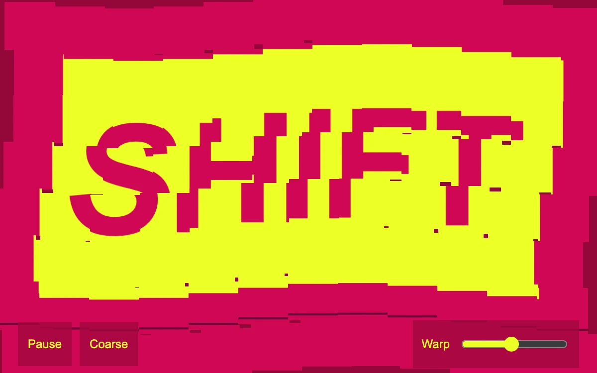

# Tile wave

> A magenta and yellow print breaks into displaced tiles while its type stays recognizable.

- **Common name:** Tile distortion text
- **Category:** Animation & motion
- **Live demo:** https://www.subframe.com/motion/tile-wave
- **Source:** Subframe (original, MIT)
- **Dependencies:** none

## Use case

Kinetic posters, animated image treatments, and graphic transition studies.

## Interaction

Change warp amount, switch tile density, or pause

## Look

Hot magenta poster with a yellow panel and heavy magenta sans-serif type, sliced into offset rectangular tiles, with dark magenta control chips along the bottom.

## Motion

Each frame redraws the print as tiles offset by two slow crossing sine waves, rows shearing sideways and columns bobbing; a warp slider scales offsets and a toggle doubles density.

## How to adapt

`paintArt` draws the source print to an offscreen canvas and `draw` slices it into `cols` × `rows` tiles shifted by sines of `phase`; tune `amount`, the 0.55/0.3 multipliers and the 0.65 speed in `tick`. Replace `paintArt` with your own artwork.

## Reduced motion

The tile field stays still. Warp and density controls redraw a static composition.

## Limitations

Canvas 2D source slicing and sine offsets, not cloth physics or a WebGL shader.

## Taxonomy

- **Components:** text, image
- **Triggers:** ambient
- **Techniques:** canvas, distortion
- **Feel:** bold, playful
- **Contexts:** landing, editorial
- **Tags:** canvas, tiles, distortion, typography, print, wave, slices
- **Also known as:** glitch text effect, sliced image wave, tile displacement, kinetic poster, mosaic warp
- **Surface color:** `#cf0754`

## Code

See [`component.tsx`](component.tsx).
