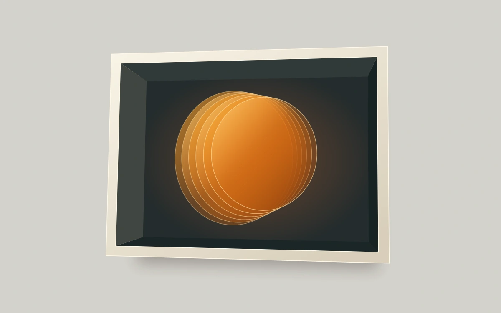

# A card with some depth

> Six translucent amber planes shift against a deep frame as a sculpture follows the pointer.

- **Common name:** 3D tilt card
- **Category:** Components & interactions
- **Live demo:** https://www.subframe.com/motion/tilt-card
- **Source:** Motion Primitives (adapted, MIT) — https://motion-primitives.com/docs/tilt · [original code](https://github.com/ibelick/motion-primitives/blob/120f64f6ca60348e251f929e9c81f11ccbe45eda/components/core/tilt.tsx)
- **Dependencies:** motion@12.0.5

## Use case

Give a featured collectible or artwork depth through actual layered geometry.

## Interaction

Move the pointer, drag, or use arrow keys to tilt

## Look

Warm grey background with a cream-rimmed deep shadow-box frame, dark slate interior and a stack of translucent glowing amber discs at its centre.

## Motion

Pointer movement tilts the deep frame and six amber planes in projected 3D, up to 18° each way, on a spring (stiffness 230, damping 26); leaving springs back to rest.

## How to adapt

`useSpring` smooths the `x` and `y` motion values, and `draw` calls `geometry` on each change to rewrite SVG path `d` attributes (`box`, `planes`, `rim`). Tune the spring and the 36° range in `geometry`; replace its elliptical `planes` with your own layered shapes.

## Reduced motion

The artwork remains at a fixed viewing angle; pointer and keyboard tilting are disabled.

## Limitations

Six original translucent planes and a deep frame projected into one SVG; not physically traced glass. Uses Motion for spring tracking.

## Taxonomy

- **Components:** card, scene
- **Triggers:** pointer, drag
- **Techniques:** 3d, spring, parallax
- **Feel:** refined, playful
- **Contexts:** landing, editorial
- **Tags:** tilt, card, 3D, perspective, hover, pointer, spring, parallax, amber, sculpture
- **Also known as:** hover tilt effect, parallax tilt, 3D hover card, perspective card, tilt on mouse move
- **Surface color:** `#d4d2cc`

## Code

See [`component.tsx`](component.tsx).
