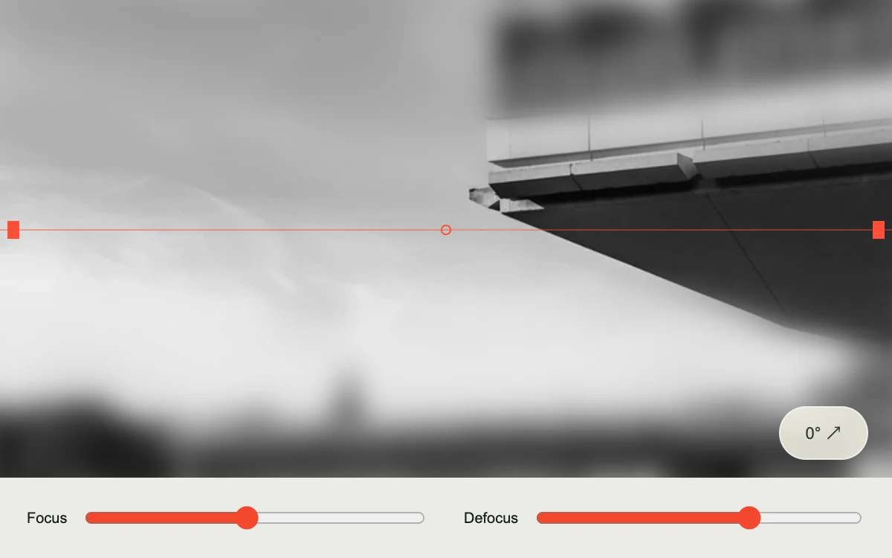

# Tilt focus

> A sharply focused strip cuts through a blurred concrete elevation, with an adjustable tilt and depth.

- **Common name:** Tilt-shift blur effect
- **Category:** Components & interactions
- **Live demo:** https://www.subframe.com/motion/tilt-focus
- **Source:** Subframe (original, MIT)
- **Dependencies:** none

## Use case

Explore an image focal plane through direct manipulation and precise controls.

## Interaction

Drag the focal plane and adjust blur or tilt.

## Look

Blurred greyscale photo of a concrete cantilever with one sharp horizontal band under a thin red guide line; pale footer with two red sliders.

## Motion

Dragging on the photo moves a sharp masked band directly with the pointer, no easing; sliders set its position and blur radius, and a button angles the band.

## How to adapt

Two stacked `img` layers do the work: `tf-soft` gets `blur(${aperture}px)` and `tf-sharp` is masked by the `mask` gradient around `focus` (±7% sharp, ±22% feather). Replace the `src` photo and `alt` text; tune the stop offsets and `aperture` range.

## Reduced motion

The focal plane responds directly to controls without interpolated movement.

## Limitations

A CSS mask over one photograph approximates a focal plane; it does not reconstruct optical depth.

## Taxonomy

- **Components:** image, editor
- **Triggers:** drag, state
- **Techniques:** blur, mask
- **Feel:** technical
- **Contexts:** app, editorial
- **Tags:** image, focus, blur, mask, direct manipulation
- **Also known as:** selective focus, depth of field blur, miniature photo effect, focus band mask
- **Surface color:** `#e5e1da`

## Assets

- [`concrete-projections.webp`](../../assets/concrete-projections.webp) — Brutalist concrete office building (Unsplash)

## Code

See [`component.tsx`](component.tsx).
