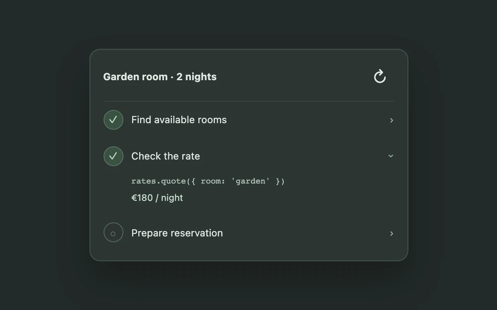

# Tool call stack

> Keep an agent’s work inspectable without exposing a wall of logs.

- **Common name:** Agent tool call log
- **Category:** Components & interactions
- **Live demo:** https://www.subframe.com/motion/tool-call-stack
- **Source:** Subframe (original, MIT)
- **Dependencies:** none

## Use case

Keep an agent’s work inspectable without exposing a wall of logs.

## Interaction

Run the sequence and inspect a step

## Look

Dark green-charcoal page with a lighter rounded card listing three steps with circular status badges, chevrons and a monospace code line under the open step.

## Motion

Clicking a step expands its detail by easing grid rows from 0fr to 1fr over 220 ms as the chevron rotates 90°; the refresh button advances the running step.

## How to adapt

Expansion is the `.reveal` grid with `transition: grid-template-rows 220ms cubic-bezier(0.2, 0.8, 0.2, 1)` and inline `gridTemplateRows`; `step` sets each `.node` state. Replace `tasks` and drive `step` from real tool-call events instead of the advance button.

## Reduced motion

Live system preference disables decorative motion; all controls remain usable. Keyboard actions settle immediately.

## Limitations

Illustrative tool calls; no network request or booking is made.

## Taxonomy

- **Components:** disclosure, list
- **Triggers:** press, state
- **Techniques:** layout, rotate
- **Feel:** subtle, technical
- **Contexts:** app
- **Tags:** agent, tool call, disclosure, execution
- **Also known as:** AI agent steps, tool use timeline, collapsible run log, agent task checklist
- **Surface color:** `#edf0f3`

## Code

See [`component.tsx`](component.tsx).
