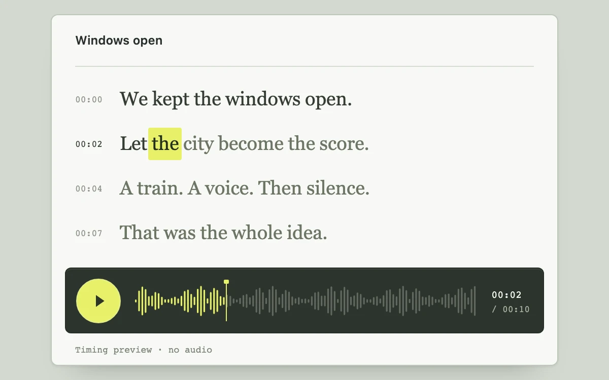

# Cue sheet

> Timecoded phrases and a compact waveform share a playhead that follows every selected word.

- **Common name:** Synced transcript player
- **Category:** Components & interactions
- **Live demo:** https://www.subframe.com/motion/transcript-follow
- **Source:** Subframe (original, MIT)
- **Dependencies:** none

## Use case

Review a voiceover through its words while retaining surrounding sentence context and precise time position.

## Interaction

Play the silent timing preview, select a word or sentence timestamp, or scrub the waveform

## Look

Sage-grey page with an off-white card of large serif transcript lines, small monospace timestamps, one lime-highlighted word and a dark green waveform transport bar.

## Motion

Playing advances a playhead across a bar waveform, filling bars lime, while a lime highlight steps word by word through the transcript and passed words darken over 150 ms.

## How to adapt

Timing is precomputed in `STARTS` from `WORDS` (split from `LINES`), with `DURATION` and `ROW_STARTS`; a `requestAnimationFrame` `tick` advances `time` and `index` picks the current word. Replace them with real alignment data, drive `time` from your audio element and use real amplitudes for the bars.

## Reduced motion

Removes decorative color transitions; word/time correspondence and user-requested playback remain available without scrolling or positional text animation.

## Limitations

Silent, authored timing with a decorative waveform. Integrations must provide actual alignment data and audio amplitude information; the waveform does not represent a real recording. Host pause and document hiding suspend playback.

## Taxonomy

- **Components:** media, text
- **Triggers:** press, drag
- **Techniques:** split-text
- **Feel:** subtle, technical
- **Contexts:** app, editorial
- **Tags:** transcript, audio, word timing, playback, cue sheet, seeking, waveform
- **Also known as:** karaoke word highlight, interactive transcript, podcast transcript player, click word to seek
- **Surface color:** `#d4d9d0`

## Code

See [`component.tsx`](component.tsx).
