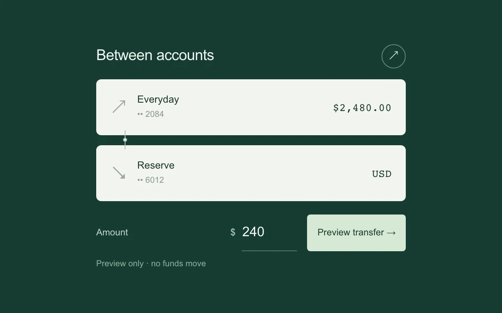

# Transfer receipt

> Two account rows join into a single completed transfer receipt.

- **Common name:** Transfer confirmation receipt
- **Category:** Components & interactions
- **Live demo:** https://www.subframe.com/motion/transfer-receipt
- **Source:** Subframe (original, MIT)
- **Dependencies:** none

## Use case

Connect the start and finish of a small local transaction preview.

## Interaction

Enter an amount, preview or cancel, and start again after completion.

## Look

Deep forest-green page with two pale sage account cards linked by a thin connector, monospace balances, an underlined amount field and a mint button.

## Motion

Submitting starts a 1.6 s pending timer; on completion the lower card slides up 12 px into the upper, corners square off and the connector scales away over 300 ms.

## How to adapt

The join is CSS keyed on `data-done`: `.receipt[data-done=true] .account:last-child` gets `translateY(-12px)` and squared radii, `.join` gets `scaleY(0)`, with `.3s cubic-bezier(.2,.8,.2,1)` transitions. The `phase` timer (`1600` ms) stands in for a real transfer; replace accounts and amounts.

## Reduced motion

The account rows join immediately; status and controls retain the full flow.

## Limitations

A local timed preview. No financial accounts, funds movement or network requests.

## Taxonomy

- **Components:** card, form
- **Triggers:** state, press
- **Techniques:** slide, morph
- **Feel:** subtle, refined
- **Contexts:** app
- **Tags:** transaction, receipt, connected-surfaces, completion, transfer, cancel
- **Also known as:** payment confirmation, money transfer flow, bank transfer success, merging account cards
- **Surface color:** `#163d32`

## Code

See [`component.tsx`](component.tsx).
