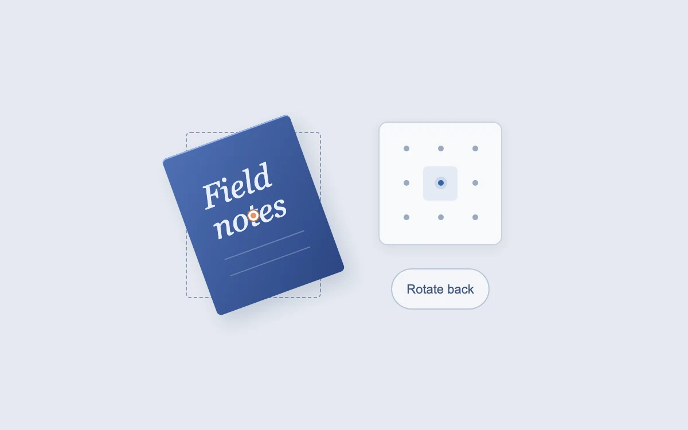

# Move the pivot

> Nine origin positions change how the same sheet rotates through space.

- **Common name:** Transform origin rotation
- **Category:** Components & interactions
- **Live demo:** https://www.subframe.com/motion/transform-origin
- **Source:** Subframe (original, MIT)
- **Dependencies:** none

## Use case

Choosing a meaningful pivot for a rotating component or layered animation.

## Interaction

Choose a pivot and rotate the sheet

## Look

Pale blue-grey canvas with a blue gradient notebook card over a dashed outline, an orange pivot pin, a white nine-dot grid and a pill button.

## Motion

A toggle rotates the sheet −20° or back around the selected anchor over 400 ms, ease-out; picking another anchor moves the pin and re-pivots the sheet instantly.

## How to adapt

The sheet's inline `transformOrigin` is derived from the `origin` index (`x`, `y` in 50% steps) and `turned` toggles a −20° rotate; easing lives in `sf-pivot-sheet` as `transition:transform 400ms cubic-bezier(.2,.8,.2,1)`. Replace the notebook sheet with your element.

## Reduced motion

Changes settle immediately; keyboard activation is immediate.

## Limitations

Nine preset anchors and one rotation, not a freeform transform gizmo.

## Taxonomy

- **Components:** editor, picker
- **Triggers:** press, state
- **Techniques:** rotate
- **Feel:** technical, subtle
- **Contexts:** app
- **Tags:** pivot, origin, rotation, transform, anchor, editor
- **Also known as:** anchor point picker, nine-point origin grid, rotation pivot control, reference point selector
- **Surface color:** `#e5e9f0`

## Code

See [`component.tsx`](component.tsx).
