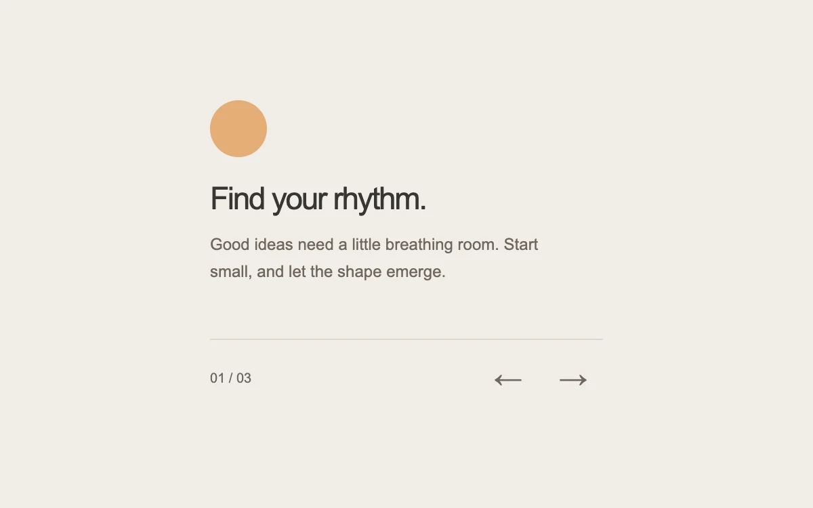

# A change of chapter

> A directional crossfade connects one small piece of content to the next.

- **Common name:** Sliding content panel
- **Category:** Components & interactions
- **Live demo:** https://www.subframe.com/motion/transition-panel
- **Source:** Motion Primitives (adapted, MIT) — https://motion-primitives.com/docs/transition-panel · [original code](https://github.com/ibelick/motion-primitives/blob/120f64f6ca60348e251f929e9c81f11ccbe45eda/components/core/transition-panel.tsx)
- **Dependencies:** motion@12.0.5

## Use case

Move between onboarding steps, short stories or explanatory cards while keeping navigation in place.

## Interaction

Move to the next chapter

## Look

Warm off-white page with a small soft-orange circle, a dark grey sans-serif headline and paragraph, a hairline rule, a step counter and arrow buttons.

## Motion

Pressing an arrow slides the outgoing chapter 18 px away while it fades and blurs, as the next enters from the opposite side over 0.24 s with a quick ease-out.

## How to adapt

The transition is the `variants` on `motion.div` inside `AnimatePresence` (`popLayout`), with `custom` carrying `direction`; tune the 18 px offset, `blur(2px)`, 0.24 s duration and ease. Replace `chapters` with your steps, keeping the `canAnimate` gating for reduced motion and keyboard.

## Reduced motion

Chapters change immediately without translation or blur; keyboard changes are also immediate.

## Limitations

Uses three bounded text panels. For longer or focusable content, review height and focus behavior.

## Taxonomy

- **Components:** card, navigation
- **Triggers:** press
- **Techniques:** slide, fade, blur
- **Feel:** subtle, refined
- **Contexts:** app, landing
- **Tags:** panel, carousel, onboarding, click, crossfade, direction, slide, content swap
- **Also known as:** onboarding carousel, directional crossfade, step content transition, animated panel swap
- **Surface color:** `#f1ede8`

## Code

See [`component.tsx`](component.tsx).
