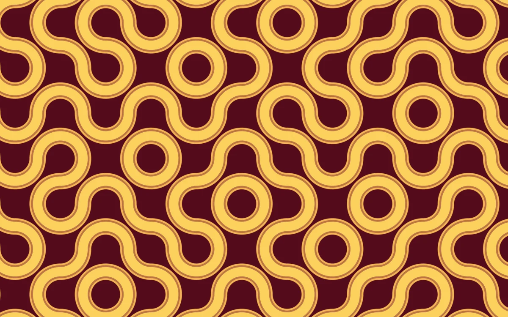

# Truchet ribbon

> Broad honey-colored ribbons join through a wine-red field of curved tiles.

- **Common name:** Truchet tile pattern shader
- **Category:** WebGL & shaders
- **Live demo:** https://www.subframe.com/motion/truchet-ribbon
- **Source:** Subframe (original, MIT)
- **Dependencies:** none

## Use case

A seamless connected pattern with consistent endpoints across randomized tile orientations.

## Interaction

Adjust ribbon width.

## Look

Thick honey-yellow ribbons with a thin inset rust outline form interlocking rings and S-curves across a flat wine-red field.

## Motion

The tile field drifts slowly leftward on the shader clock; a range slider thickens or thins the ribbons in real time, and a button pauses the drift.

## How to adapt

The pattern lives in the `FRAGMENT` shader: tune the tile scale and `u_time` drift multiplier in `main`, the `width` range driven by `u_control`, and the `bg` and `yellow` colours. Keep the canvas lifecycle, fallback and reduced-motion handling.

## Reduced motion

The elapsed-time clock stops. Parameter controls immediately update the static composition.

## Limitations

Requires WebGL 1; a static CSS swatch appears if unavailable or after context loss. Deterministic tile orientations; ribbon width changes continuously without random topology jumps.

## Taxonomy

- **Components:** background
- **Triggers:** ambient, state
- **Techniques:** shader
- **Feel:** bold, calm
- **Contexts:** landing, editorial
- **Tags:** native webgl, truchet, tiles, connected paths, pattern, print
- **Also known as:** animated pattern background, procedural tile pattern, retro curved tiles, generative wallpaper
- **Surface color:** `#5b1225`

## Code

See [`component.tsx`](component.tsx).
