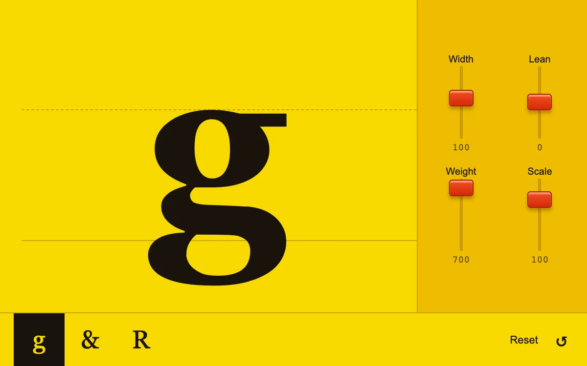

# Type instrument

> Four red faders sculpt an oversized black glyph on a yellow proofing field.

- **Common name:** Variable font controls
- **Category:** Components & interactions
- **Live demo:** https://www.subframe.com/motion/type-instrument
- **Source:** Subframe (original, MIT)
- **Dependencies:** none

## Use case

Type specimen exploration and immediate visual parameter control.

## Interaction

Move the faders, select a glyph, or reset the specimen

## Look

Bright yellow proofing field with one oversized black serif glyph on guide rules, an amber rack of four red-capped vertical faders and a glyph bar.

## Motion

Faders reshape the glyph instantly via scaleX, skewX and scale, with weight snapping between 400 and 700; a chosen glyph fades and sharpens from 3 px blur over 220 ms.

## How to adapt

Faders in `controls` set `width`, `lean`, `weight` and `scale`, applied to the glyph `span` as an inline transform; `key={glyph}` remounts it to replay `sf-type-glyph`. Replace the three Georgia glyphs and ranges; for a variable font, map faders to its axes.

## Reduced motion

Glyph changes are immediate. Faders always respond directly without tweening.

## Limitations

Uses CSS scale/skew and system Georgia weights. Width and lean are transforms, not variable-font axes; available weights vary by platform.

## Taxonomy

- **Components:** slider, text, editor
- **Triggers:** drag, state
- **Techniques:** blur, fade, scale
- **Feel:** bold, technical
- **Contexts:** editorial, app
- **Tags:** typography, faders, range, specimen, width, slant, controls
- **Also known as:** type tester, font specimen playground, glyph sliders, vertical fader controls
- **Surface color:** `#f9d900`

## Code

See [`component.tsx`](component.tsx).
