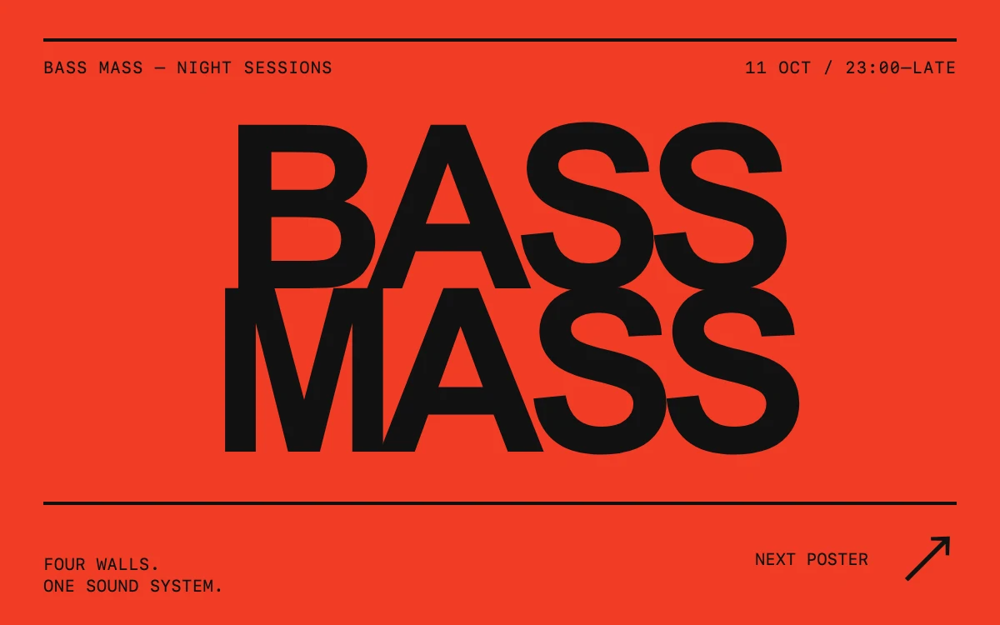

# Type under pressure

> Heavy club typography compresses and releases like a sound system finding its voice.

- **Common name:** Kinetic poster typography
- **Category:** Animation & motion
- **Live demo:** https://www.subframe.com/motion/type-press
- **Source:** Subframe (original, MIT)
- **Dependencies:** none

## Use case

Create an expressive campaign headline or event poster where the type itself carries the identity.

## Interaction

Print the next poster

## Look

Flat vermilion poster with huge tightly tracked black grotesque letters stacked in two lines between thick black rules and small monospace captions.

## Motion

Pressing the button swaps the headline; top letters rise from narrow slivers and bottom letters drop from wide flat bars, staggered 35 ms over 760 ms ease-out.

## How to adapt

Letter motion is the `sf-typepress-set` and `sf-typepress-set-bottom` keyframes (760ms `cubic-bezier(.16,1,.3,1)`) with per-letter `animationDelay` steps of 35 ms; re-keying the `h3` by `edition` replays them. Replace the `words` pairs and poster copy, retuning type size for longer words.

## Reduced motion

New editions appear immediately. Keyboard activation also skips the letter motion.

## Limitations

The two four-letter headlines are designed for this composition. Retune the type size and line height for longer copy.

## Taxonomy

- **Components:** text
- **Triggers:** press
- **Techniques:** split-text, stagger, scale
- **Feel:** bold
- **Contexts:** landing, editorial
- **Tags:** kinetic typography, editorial, poster, music, club, compression, stagger, type, replay, CSS
- **Also known as:** per-letter headline animation, squash and stretch text, animated event poster, staggered letter reveal
- **Surface color:** `#f13c25`

## Code

See [`component.tsx`](component.tsx).
