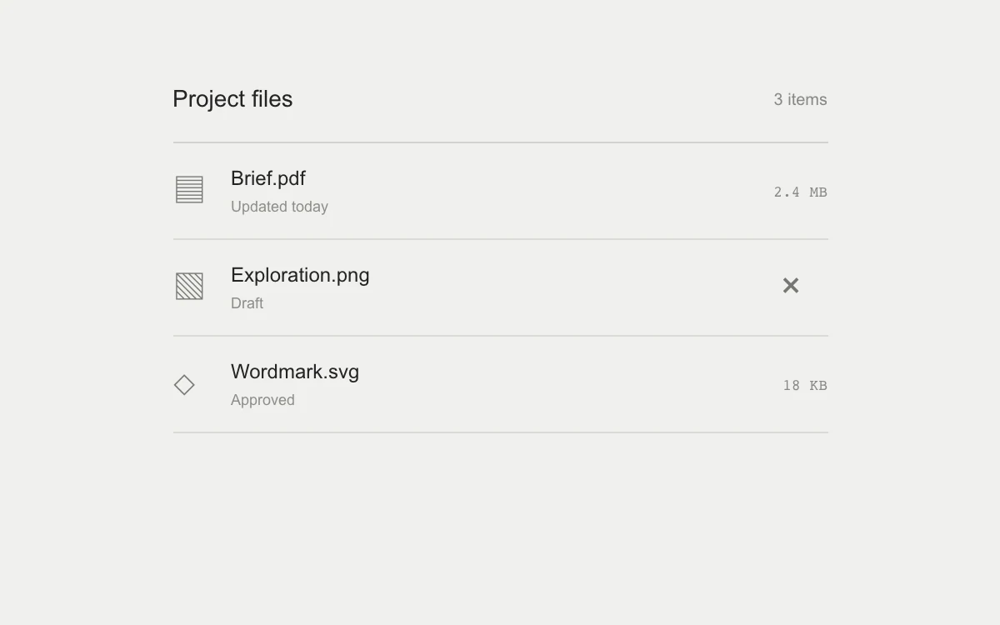

# Undo removal

> A removed draft can be restored from a compact notification with a visible lifetime.

- **Common name:** Undo toast
- **Category:** Components & interactions
- **Live demo:** https://www.subframe.com/motion/undo-removal
- **Source:** Subframe (original, MIT)
- **Dependencies:** none

## Use case

Make a reversible file action quick while keeping recovery within reach.

## Interaction

Remove the draft, pause expiry by hover or focus, and Undo or reset after expiry.

## Look

Light warm-grey page with a minimal three-row file list: thin dividers, outline glyph icons, grey metadata and small monospace file sizes.

## Motion

Removing a row slides a toast up 8 px with a 0.2 s fade; its orange bar shrinks linearly through an 8 s countdown that pauses on hover or focus.

## How to adapt

The countdown is the `React.useEffect` that decrements `remaining` each second unless `hold` (hover or focus) is true; the toast enters via `undo-toast-w2` and the bar's `scaleX` follows `remaining / 8`. Replace the file rows and wire `remove` and `restore` to real deletion.

## Reduced motion

Removal and recovery appear instantly; the functional expiry timer remains available and pauses during interaction.

## Limitations

One local draft removal, with an eight-second Undo window; no filesystem changes.

## Taxonomy

- **Components:** notification, list
- **Triggers:** press, hover, enter
- **Techniques:** slide, fade, scale
- **Feel:** subtle
- **Contexts:** app
- **Tags:** undo, toast, removal, reversible, transaction, timer, pause, recovery
- **Also known as:** undo snackbar, delete with undo, toast with countdown, reversible delete
- **Surface color:** `#f0f0ee`

## Code

See [`component.tsx`](component.tsx).
