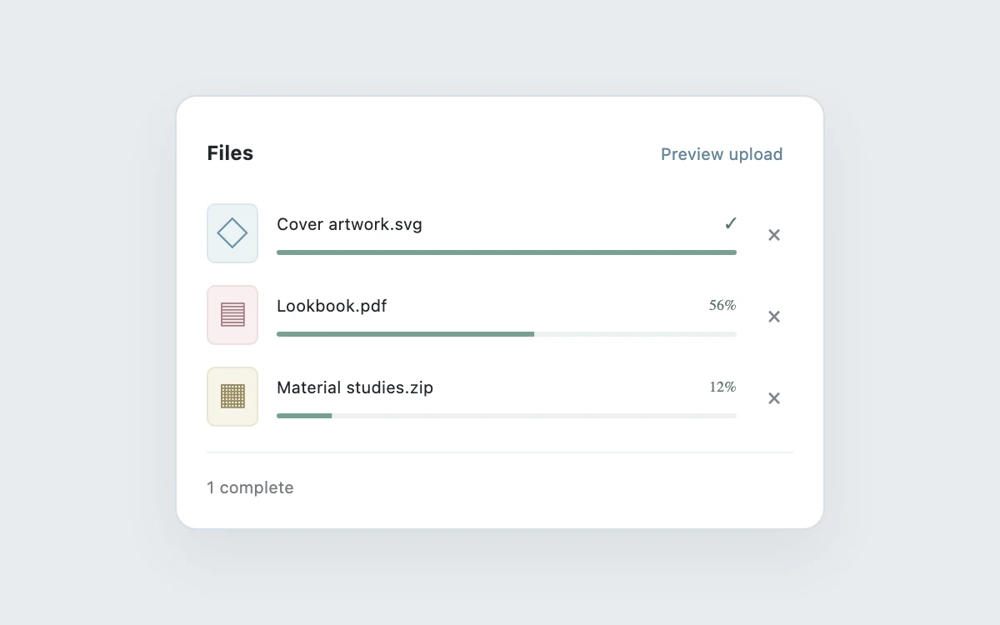

# Upload queue

> Make parallel file progress and cancellation readable in a small space.

- **Common name:** File upload progress list
- **Category:** Components & interactions
- **Live demo:** https://www.subframe.com/motion/upload-queue
- **Source:** Subframe (original, MIT)
- **Dependencies:** none

## Use case

Make parallel file progress and cancellation readable in a small space.

## Interaction

Start, cancel, or retry an upload

## Look

White rounded card on a pale blue-grey page listing three files with pastel file-type tiles, thin sage progress bars, small percentages and remove crosses.

## Motion

Pressing preview ticks every 400 ms, advancing each file at its own rate; each bar's fill scales horizontally with a 400 ms linear transition, and finished rows show a check.

## How to adapt

Simulated progress is the `setInterval` effect gated by `play` (`400` ms ticks, step `4 + i * 2`); each bar is a `scaleX` on `.progress i` with `transition: transform 400ms linear`. Replace `names` and the timer with real upload progress.

## Reduced motion

Live system preference disables decorative motion; all controls remain usable. Keyboard actions settle immediately.

## Limitations

Explicit simulated upload preview; no files or data leave the browser. Host pause stops the timer; reduced motion keeps values updating without tweening.

## Taxonomy

- **Components:** progress, list
- **Triggers:** loading, press
- **Techniques:** scale
- **Feel:** subtle
- **Contexts:** app
- **Tags:** upload, progress, queue, files, cancel
- **Also known as:** multi-file uploader, upload progress bars, attachment upload panel, file transfer queue
- **Surface color:** `#edf0f3`

## Code

See [`component.tsx`](component.tsx).
