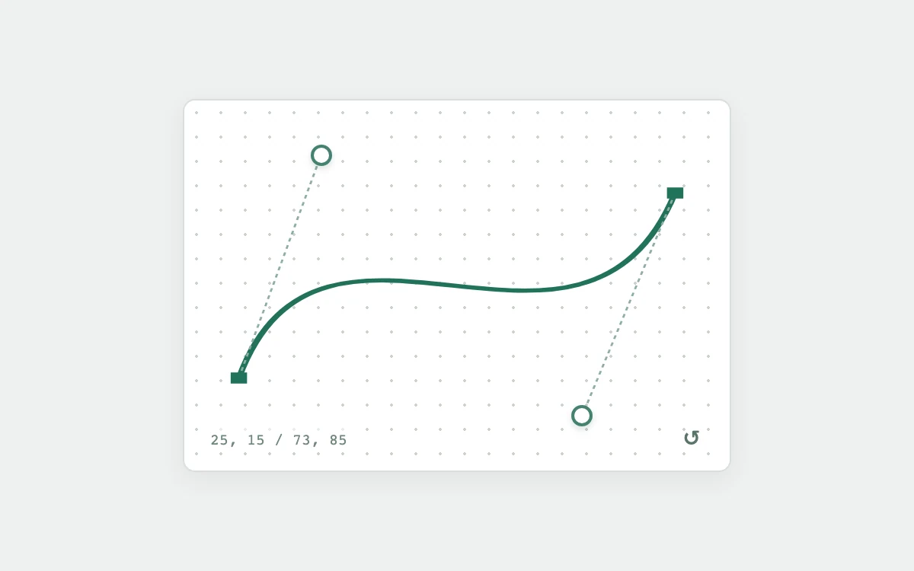

# Vector handles

> Two generous control points reshape a cubic path without hiding its construction.

- **Common name:** Bezier curve editor
- **Category:** Components & interactions
- **Live demo:** https://www.subframe.com/motion/vector-handles
- **Source:** Subframe (original, MIT)
- **Dependencies:** none

## Use case

Path shaping, motion trajectory editing, and teaching tangent relationships.

## Interaction

Drag a handle or move it with arrow keys

## Look

Pale grey page with a white dotted-grid card holding a dark green cubic curve, square endpoints, ring handles on dashed tangents and monospace coordinates.

## Motion

Dragging either ring handle reshapes the cubic path and dashed tangents live, the handle dot scaling 1.15× while pressed; arrow keys nudge it 2 units, or 10 with Shift.

## How to adapt

`points` holds the two control points in a 0–100 `viewBox`, clamped by `update` and written into the cubic `d` string; endpoints stay fixed at `M10 75` and `90 25`. Wire `points` to your easing or path data, keeping pointer capture and arrow-key handling.

## Reduced motion

Input follows immediately; press decoration has no transition.

## Limitations

Single cubic segment with fixed endpoints, not a complete path editor or easing-time solver.

## Taxonomy

- **Components:** editor
- **Triggers:** drag, keyboard
- **Techniques:** path, morph
- **Feel:** technical, subtle
- **Contexts:** app
- **Tags:** bezier, vector, path, handles, curve, editor, svg
- **Also known as:** easing curve editor, control point handles, pen tool handles, draggable SVG path
- **Surface color:** `#eef0ef`

## Code

See [`component.tsx`](component.tsx).
