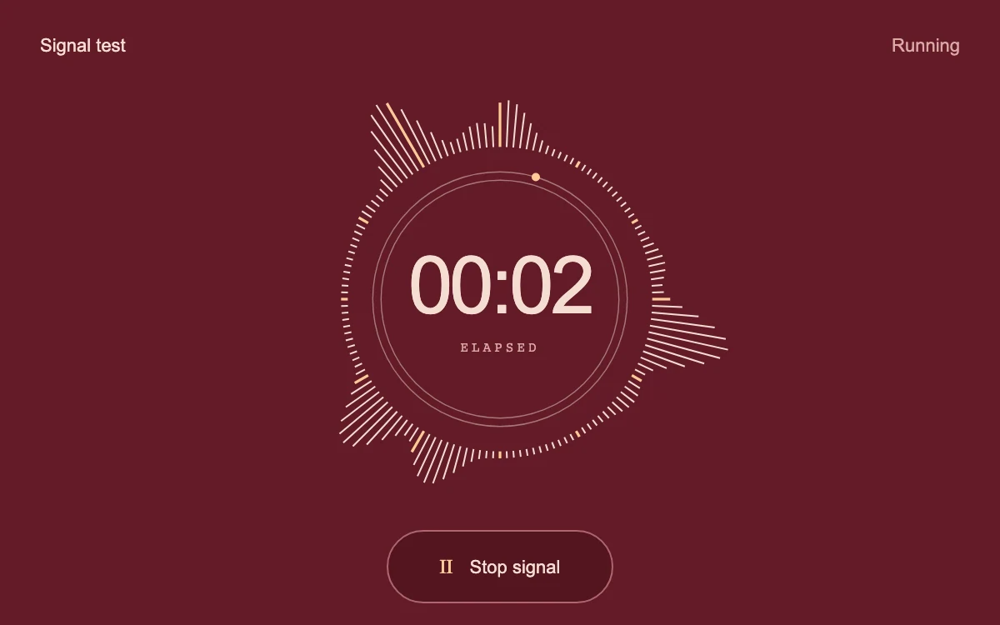

# Vector monitor

> A circular signal grows into fine radial strokes around a live elapsed-time readout.

- **Common name:** Radial audio waveform
- **Category:** Animation & motion
- **Live demo:** https://www.subframe.com/motion/vector-monitor
- **Source:** Subframe (original, MIT)
- **Dependencies:** none

## Use case

Visual feedback for signal tests, audio audition, or capture interfaces.

## Interaction

Start and stop the simulated signal

## Look

Deep oxblood field with a ring of fine cream radial strokes and amber ticks around a double circle, a large centred timer and pill button.

## Motion

Lobes of longer radial strokes travel around the ring as two sine waves drift in phase, an amber dot orbits slowly and the timer counts up; stopping collapses the strokes.

## How to adapt

Everything is drawn in `draw`: 144 strokes whose length comes from `signal` times `envelope`, plus the `sweep` dot and `clock` readout. Replace `signal` with analyser levels for real audio, and tune the `time` multipliers and stroke colours.

## Reduced motion

The radial signal and elapsed clock freeze; the signal state remains operable.

## Limitations

Procedural signal only. No microphone capture, audio analysis, or stored recording.

## Taxonomy

- **Components:** media, number
- **Triggers:** ambient, press
- **Techniques:** canvas
- **Feel:** technical, refined
- **Contexts:** app
- **Tags:** signal, radial, waveform, canvas, time, meter, oxblood
- **Also known as:** circular audio visualizer, radial equalizer, recording timer, voice memo visualizer
- **Surface color:** `#631b28`

## Code

See [`component.tsx`](component.tsx).
