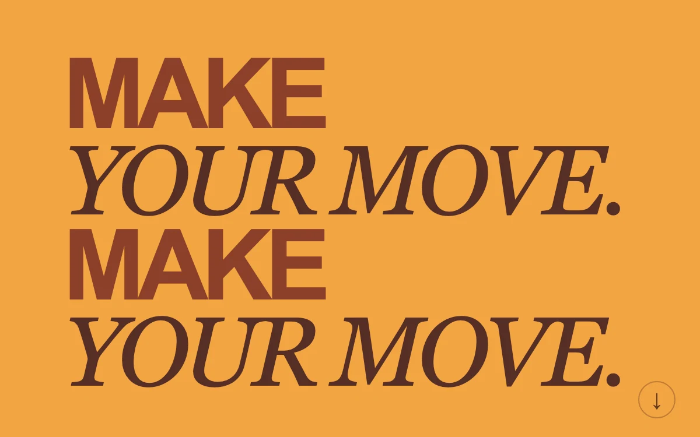

# Fast company

> A compact typographic strip leans with scrolling speed and relaxes when movement stops.

- **Common name:** Scroll velocity text skew
- **Category:** Animation & motion
- **Live demo:** https://www.subframe.com/motion/velocity-type
- **Source:** Subframe (original, MIT)
- **Dependencies:** none

## Use case

Make a bounded editorial scroll treatment respond to the reader rather than an autoplay loop.

## Interaction

Scroll the specimen

## Look

Saturated orange field with stacked oversized type alternating heavy rust sans-serif and dark brown italic serif lines, plus a small circled arrow bottom right.

## Motion

Scrolling slides the type left at 0.32× scroll distance and skews it up to 15° by scroll speed; skew eases back to zero 100 ms after scrolling stops.

## How to adapt

The `onScroll` handler sets `skew` from `velocity * 6` (clamped to ±15°) and a `translateX` of 0.32× `offset`; `timer` zeroes the skew after 100 ms and `.type` eases transforms over 0.16 s. Replace the lettering and palette in `.sf-velocity-type`.

## Reduced motion

Reduced motion keeps the lettering static while its scroll surface remains available. Changing the preference live immediately removes translation and skew.

## Limitations

Original demonstration content; adapt labels and state to the host product.

## Taxonomy

- **Components:** text
- **Triggers:** scroll
- **Techniques:** distortion, slide
- **Feel:** bold
- **Contexts:** editorial, landing
- **Tags:** scroll velocity, typography, skew, responsive motion
- **Also known as:** skew on scroll, scroll speed text effect, kinetic typography scroll, scroll-linked headline
- **Surface color:** `#f2a543`

## Code

See [`component.tsx`](component.tsx).
