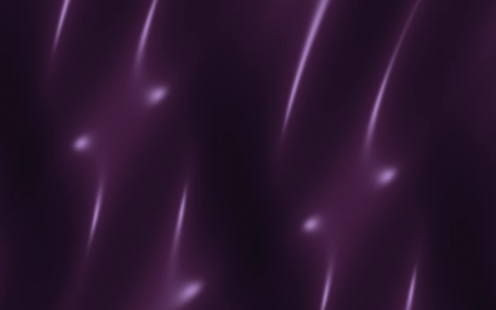

# Velvet dunes

> Deep aubergine cloth catches a narrow silver-blue grazing light.

- **Common name:** Velvet fabric shader
- **Category:** WebGL & shaders
- **Live demo:** https://www.subframe.com/motion/velvet-dunes
- **Source:** Subframe (original, MIT)
- **Dependencies:** none

## Use case

Luxury fashion, music artwork, and material studies that need quiet depth.

## Interaction

Adjust light

## Look

Full-bleed deep aubergine cloth with slanted folds, narrow lilac-silver highlights along the ridges and fine thread lines.

## Motion

The folds undulate very slowly as sine terms in the cloth height drift with time, sliding the grazing sheen; the slider swings the light from left to right.

## How to adapt

The cloth is the `FRAGMENT` shader: `cloth` is the fold heightfield (frequencies and `u_time` rates), `sheen` the specular exponent `34.0`, and `threads` the weave lines; recolour the base and sheen `vec3` values. Keep the WebGL lifecycle and reduced-motion branch.

## Reduced motion

A representative frame remains still. Live system preference changes immediately stop the loop; the range control continues to update the still image.

## Limitations

Requires WebGL 1. A static CSS fallback appears when unavailable or after context loss. A height-field material study; no cloth simulation or external fabric texture.

## Taxonomy

- **Components:** background
- **Triggers:** ambient, state
- **Techniques:** shader, glow
- **Feel:** calm, refined
- **Contexts:** landing, editorial
- **Tags:** velvet, satin, fabric, cloth, folds, native webgl
- **Also known as:** satin fabric background, silk shader, draped cloth backdrop, luxury fabric texture, sheen background
- **Surface color:** `#241d31`

## Code

See [`component.tsx`](component.tsx).
