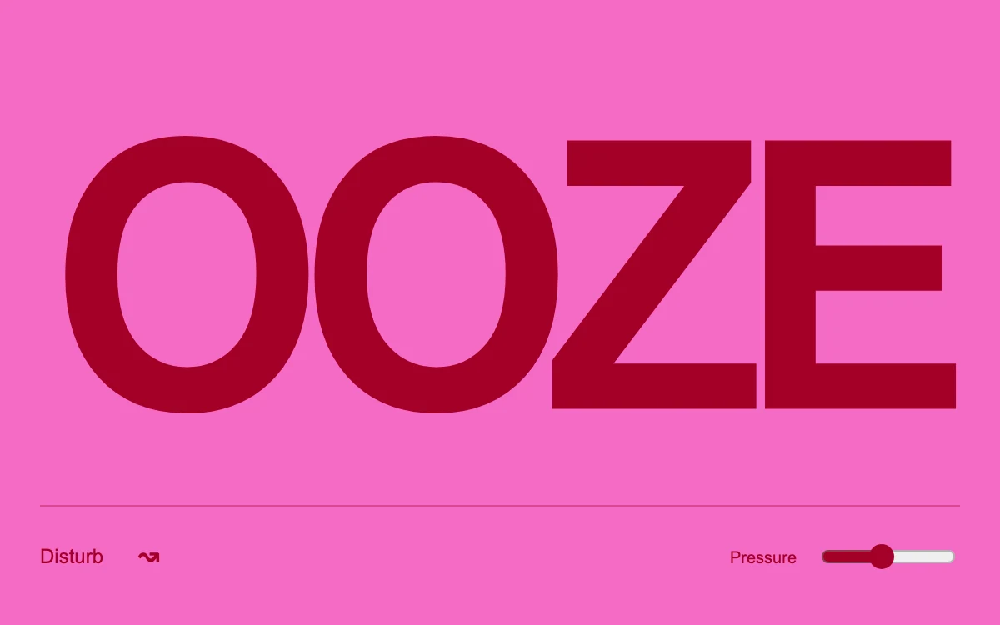

# Viscous type

> Deep-red lettering distorts under pointer velocity, then settles across a vivid pink field.

- **Common name:** Liquid text distortion
- **Category:** Animation & motion
- **Live demo:** https://www.subframe.com/motion/viscous-type
- **Source:** Subframe (original, MIT)
- **Dependencies:** none

## Use case

Expressive wordmarks and short editorial typography with tactile feedback.

## Interaction

Move across the letters or press Disturb; tune pressure

## Look

Huge heavy deep-red sans-serif wordmark set tight on a flat hot-pink field, with a thin rule, text button and small slider along the bottom.

## Motion

Fast pointer movement pumps a noise displacement that warps the letters like liquid, rising quickly and then decaying back to crisp type; a Disturb button injects a fixed burst.

## How to adapt

Velocity becomes `target` in `disturb` (scaled by `pressure`, capped at 48); `tick` eases `strength` toward it and decays `target`, writing the `feDisplacementMap` `scale`. Tune `baseFrequency` on `feTurbulence` and the 0.77/0.965 factors; replace the wordmark and colours.

## Reduced motion

The lettering remains undistorted; the pressure value stays editable.

## Limitations

SVG filtering repaints the text region. Keep distortion isolated from functional interface text.

## Taxonomy

- **Components:** text
- **Triggers:** pointer, press
- **Techniques:** distortion, noise
- **Feel:** playful, bold
- **Contexts:** landing, editorial
- **Tags:** typography, svg-filter, displacement, turbulence, velocity, pointer, liquid
- **Also known as:** gooey text hover, wobbly text effect, SVG displacement text, melting typography, jelly headline
- **Surface color:** `#f56bc4`

## Code

See [`component.tsx`](component.tsx).
