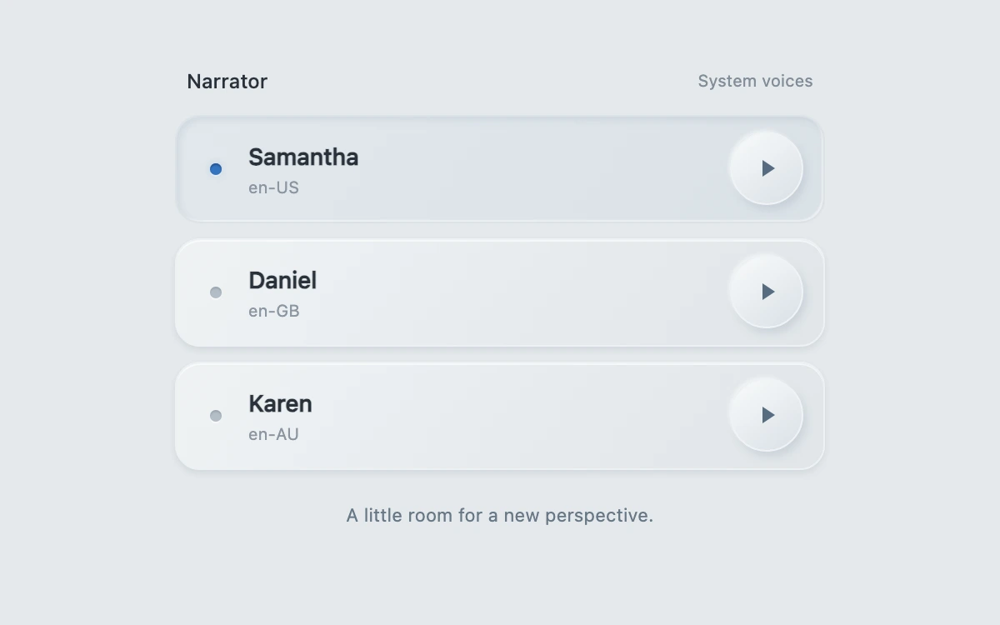

# Voice audition

> A sculpted three-voice tray separates narrator selection from tactile playback controls.

- **Common name:** Voice picker
- **Category:** Components & interactions
- **Live demo:** https://www.subframe.com/motion/voice-audition
- **Source:** Subframe (original, MIT)
- **Dependencies:** none

## Use case

Compare the same line across available system voices before choosing a narrator.

## Interaction

Select a narrator or press its play key to audition the shared phrase.

## Look

Soft neumorphic grey-blue tray of three rounded voice rows with raised circular play keys; the selected row sits inset with a blue indicator dot.

## Motion

Pressing a play key sinks it 1 px into an inset shadow; five blue bars pulse in a staggered 700 ms loop and the spoken word highlights on boundary events.

## How to adapt

Playback is `preview`, which speaks `LINE` with `SpeechSynthesisUtterance` and sets `word` from `onboundary`; the bars are `.sf-va-levels` animated by `@keyframes sf-va-level` with `animationDelay` offsets. Replace `LINE` and the voice choice in `load`; bars are decorative, not amplitude.

## Reduced motion

Playback state stays legible through a static pressed key; animated bars stop. Real speech still plays on request.

## Limitations

Uses up to three available system voices, preferring different available English locales. Voice names, quality, availability and word-boundary events vary by browser/device. Bars indicate playback, not measured amplitude.

## Taxonomy

- **Components:** picker, media
- **Triggers:** press, state
- **Techniques:** loop, stagger
- **Feel:** subtle, refined
- **Contexts:** app
- **Tags:** voice, audition, speech, narrator, audio, neumorphic, playback, selection
- **Also known as:** text-to-speech voice selector, voice preview list, TTS voice chooser, narrator selection, speech sample player
- **Surface color:** `#e4e8eb`

## Code

See [`component.tsx`](component.tsx).
