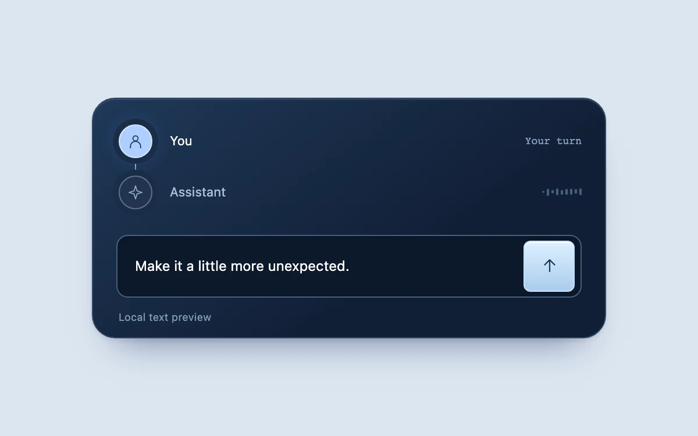

# Turn relay

> An illuminated connection follows the handoff between a typed message and an interruptible reply.

- **Common name:** Voice agent status
- **Category:** Components & interactions
- **Live demo:** https://www.subframe.com/motion/voice-turn-taking
- **Source:** Subframe (original, MIT)
- **Dependencies:** none

## Use case

Make conversation ownership visible while a voice or text assistant prepares and delivers a response.

## Interaction

Send the prepared phrase or write your own, then interrupt a reply or send another message

## Look

Dark navy gradient card on pale blue with two round speaker nodes on a thin vertical line above a dark composer and pale-blue send key.

## Motion

Sending slides a streak down the connector in 440 ms, lighting the assistant node; dots pulse while thinking, then reply words brighten 220 ms apart as level bars oscillate.

## How to adapt

`phase` drives the `connection` streak, node glow and `levels` bars via `data-phase` CSS; the interval effect holds thinking for 850 ms, then reveals words every 220 ms through `shown`. Swap `REPLIES` and that timer for real agent events; keep `interrupt`.

## Reduced motion

Stops waveform and thinking loops, removes handoff movement and makes visual state changes immediate. The explicitly initiated reply still progresses through its words.

## Limitations

Silent local text simulation with three authored replies. No microphone, speech recognition, model connection or network request. Connect actual service events before representing a live voice conversation. Host pause and document hiding suspend the elapsed-time clock.

## Taxonomy

- **Components:** notification, text, input
- **Triggers:** state, loading, press
- **Techniques:** glow, slide, stagger, fade
- **Feel:** refined, subtle
- **Contexts:** app
- **Tags:** voice, agent, conversation, turn taking, interruption, composer, status
- **Also known as:** AI assistant status, voice assistant UI, chat thinking indicator, conversation handoff indicator, interruptible AI reply
- **Surface color:** `#dce5f0`

## Code

See [`component.tsx`](component.tsx).
