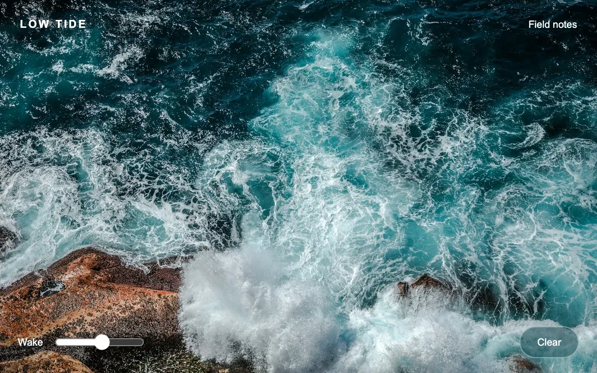

# Wake image

> A deep-blue sea photograph bends under short-lived wave fronts left by a moving pointer.

- **Common name:** Water ripple image effect
- **Category:** WebGL & shaders
- **Live demo:** https://www.subframe.com/motion/wake-image
- **Source:** Subframe (original, MIT)
- **Dependencies:** none

## Use case

Add a local refractive wake to a still image without a simulation package.

## Interaction

Move across the water and adjust the wake strength.

## Look

Full-bleed aerial photograph of turquoise surf breaking over rust-red rocks, with white letterspaced caps header, a white range slider and a translucent pill button.

## Motion

Pointer movement (or touch drag) drops up to twelve marks that each emit an expanding ring wave, refracting the photo for 2.6 s as it fades; a slider scales strength.

## How to adapt

The wake is the `fragment` shader: each of `marks[12]` emits a ring with `front=age*.16` decaying by `exp(-age*1.9)` over `2.6` s; `move` writes marks every `18` ms. Tune `strength` and replace `coastal-break.webp` in both the `img` and `image.src`.

## Reduced motion

The photograph remains still; the distortion strength resolves to zero.

## Limitations

Twelve analytic pointer marks form the wake; this is not a fluid solver. WebGL 1 is optional, with the original photograph retained underneath.

## Taxonomy

- **Components:** image, cursor
- **Triggers:** pointer
- **Techniques:** shader, distortion
- **Feel:** calm, refined
- **Contexts:** landing, editorial
- **Tags:** image, refraction, pointer trail, wave, WebGL
- **Also known as:** ripple hover effect, liquid cursor trail, water distortion on hover, image refraction trail
- **Surface color:** `#053752`

## Assets

- [`coastal-break.webp`](../../assets/coastal-break.webp) — Aerial photography of ocean (Unsplash)

## Code

See [`component.tsx`](component.tsx).
