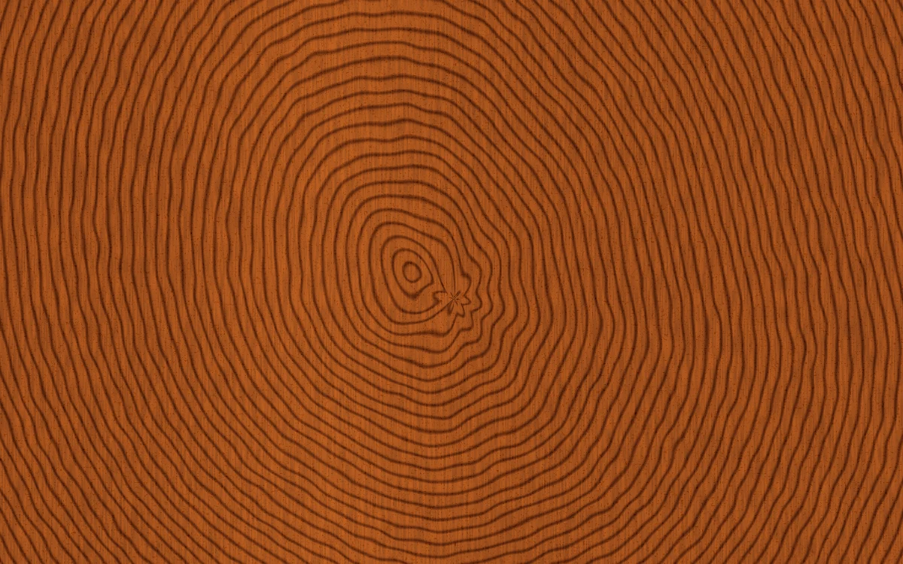

# Walnut cut

> Warm walnut changes from end-grain rings to lengthwise growth as the cut turns.

- **Common name:** Wood grain shader
- **Category:** WebGL & shaders
- **Live demo:** https://www.subframe.com/motion/walnut-cut
- **Source:** Subframe (original, MIT)
- **Dependencies:** none

## Use case

Compare directional material grain through an adjustable cut plane.

## Interaction

Adjust cut angle.

## Look

Full-bleed warm orange-brown walnut surface with dark wavy concentric growth rings around an off-centre pith, fine vertical fibre streaks and pores.

## Motion

A soft warm sheen drifts side to side across the wood on a roughly 35 s sine; the cut-angle slider tilts the slicing plane, stretching end-grain rings into lengthwise stripes.

## How to adapt

The `FRAGMENT` shader does everything: `grain` tilts the sampling plane by `u_control` and returns ring radius, `fract(r*24.)` sets ring density, and `reflection` is the moving sheen. Recolour the earlywood and latewood tones in `col`; keep the context-loss and reduced-motion handling.

## Reduced motion

The elapsed-time clock stops. Parameter controls immediately update the static composition.

## Limitations

Requires WebGL 1; a static CSS swatch appears if unavailable or after context loss. Procedural growth-ring approximation with pores; no scanned wood texture or species-accurate anatomy.

## Taxonomy

- **Components:** background
- **Triggers:** state, ambient
- **Techniques:** shader, noise, glow
- **Feel:** calm, refined
- **Contexts:** landing, editorial
- **Tags:** native webgl, wood, grain, cut plane, growth rings, material
- **Also known as:** wood texture background, tree ring pattern, procedural timber material, end grain texture
- **Surface color:** `#62301b`

## Code

See [`component.tsx`](component.tsx).
