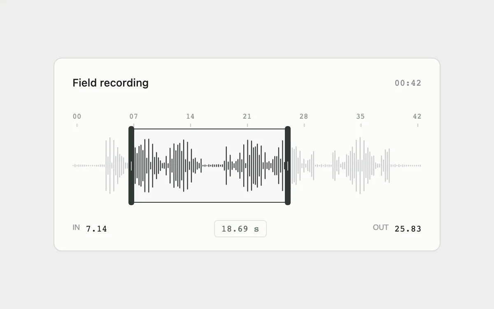

# Waveform trim

> Fine audio samples and quiet regions make direct range trimming precise and legible.

- **Common name:** Audio trim editor
- **Category:** Components & interactions
- **Live demo:** https://www.subframe.com/motion/waveform-trim
- **Source:** Subframe (original, MIT)
- **Dependencies:** none

## Use case

Select a precise excerpt without losing the surrounding recording.

## Interaction

Drag trim handles or the selection; use arrows, Shift+arrows, Home or End

## Look

Light grey page with a white rounded card holding a fine vertical-bar waveform, a monospace time ruler, dark trim handles and monospace in/out readouts.

## Motion

Dragging a dark handle or the selected region moves the trim range 1:1 with the pointer, darkening bars inside and greying those outside; arrow keys nudge 1% or 5%.

## How to adapt

Range state is `range` (percent), updated by `down`, `move`, `change` and `key` with a 5% minimum gap; `BARS` is synthetic amplitude data and 0.42 converts percent to seconds. Replace `BARS` with decoded peaks and wire `range` to playback or export.

## Reduced motion

Live system preference disables decorative motion; all controls remain usable. Keyboard actions settle immediately.

## Limitations

Synthetic amplitude data. Range changes are local; no audio decoding, destructive trim or export.

## Taxonomy

- **Components:** media, editor, slider
- **Triggers:** drag, keyboard
- **Techniques:** slide
- **Feel:** technical, subtle
- **Contexts:** app
- **Tags:** audio, trim, waveform, range, editor, pointer capture, direct manipulation
- **Also known as:** audio range selector, clip trimmer, trim handles, waveform range slider
- **Surface color:** `#eeeeeb`

## Code

See [`component.tsx`](component.tsx).
