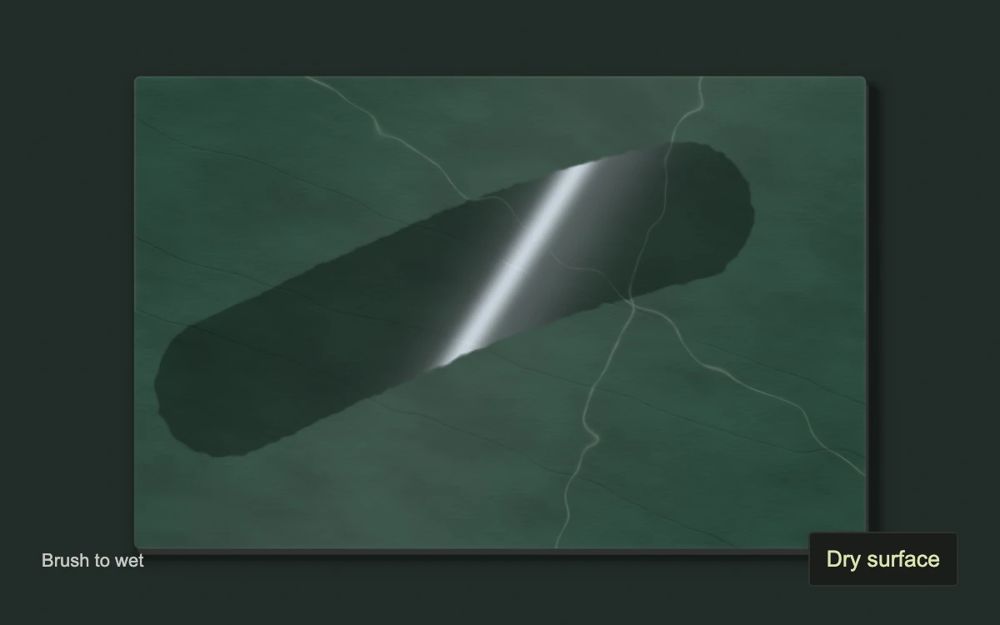

# After the rain

> Water brushed across deep green stone accumulates into a glossy region, revealing a sharp grazing reflection beside the same dry material.

- **Common name:** Paintable wet material and clearcoat shader
- **Category:** WebGL & shaders
- **Live demo:** https://www.subframe.com/motion/wet-finish
- **Source:** Subframe (original, MIT)
- **Dependencies:** none

## Use case

Show the difference between matte and coated finishes in a tactile material selector or product story.

## Interaction

Drag to wet the stone. Arrow keys place the brush and Space or Enter paints; Dry surface clears it.

## Look

A large beveled mineral-green stone sample seen straight from above on dark green, thin light veins and subdued dark fractures; a brushed wet region catches a crisp white reflection with an irregular absorbent edge.

## Motion

A persistent canvas mask records contiguous brush strokes. Wetness changes diffuse tint and a separate clearcoat highlight; wet roughness changes the highlight width. Drying fades the mask only while active and visible.

## How to adapt

`DEFAULT_CONFIG` and the `config` prop expose brush radius, dry and wet roughness, and drying time. `relief` defines the original stone field. `paint` updates the persistent `mask`; `step` advances drying, while `useSurface` uploads it as a texture and stops rendering when dry or paused.

## Reduced motion

Direct painting remains available. Automatic drying freezes under reduced motion; Dry surface is an immediate deterministic reset.

## Limitations

A procedural stone sample, screen-space brush mask and authored strip-light response, not a physically calibrated BRDF or fluid simulation. The bounded mask dries while active and visible. Requires WebGL 1; interaction disables with an explicit fallback and resumes after context restoration.

## Taxonomy

- **Components:** scene, cursor, button
- **Triggers:** drag, keyboard, press
- **Techniques:** shader, mask, canvas
- **Feel:** refined, calm
- **Contexts:** landing, editorial
- **Tags:** wet stone, clearcoat, roughness, material finish, brush, persistent mask, reflection, soapstone
- **Also known as:** wetness painting, roughness painting, wet and dry material, clear coat reflection, paintable finish comparison
- **Surface color:** `#24372e`

## Code

See [`component.tsx`](component.tsx).
