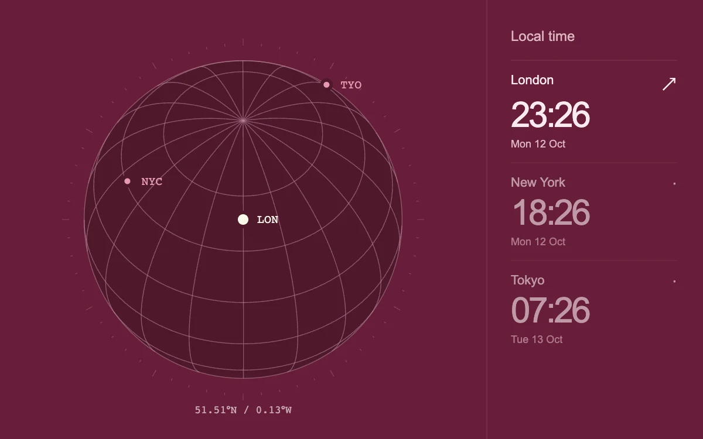

# World clock orbit

> An oxblood coordinate globe turns toward three cities while their real local clocks stay aligned.

- **Common name:** Time zone globe
- **Category:** Components & interactions
- **Live demo:** https://www.subframe.com/motion/world-clock-orbit
- **Source:** Subframe (original, MIT)
- **Dependencies:** none

## Use case

Combine a location selector with accurate time-zone context for a distributed team.

## Interaction

Select a city or drag the globe. Focus the globe and use arrow keys; Home returns to the selected city.

## Look

Oxblood panel with a pale pink wireframe globe, cream and pink city dots with monospace codes, and a right column of large clock times.

## Motion

Selecting a city turns the globe the short way to centre it (480 ms, cubic ease-out); dragging rotates it directly and the clocks update every second.

## How to adapt

`focusPlace` tweens `camera` toward `aim` in its `tick` (480 ms, `1 - (1 - f) ** 3`), using `normalize` for the shortest yaw; `project` and `draw` render the orthographic sphere. Replace `PLACES` with your cities and IANA zones.

## Reduced motion

Selecting a city changes the camera instantly; direct drag remains available.

## Limitations

A geographic coordinate sphere without a country-boundary dataset. Times come from Intl and the device clock.

## Taxonomy

- **Components:** chart, number, picker
- **Triggers:** press, drag
- **Techniques:** canvas, 3d, rotate
- **Feel:** refined, technical
- **Contexts:** app, dashboard
- **Tags:** globe, timezone, clock, canvas, projection, drag, coordinates
- **Also known as:** world clock widget, rotating globe selector, timezone picker, interactive wireframe globe, team time zones
- **Surface color:** `#671d39`

## Code

See [`component.tsx`](component.tsx).
