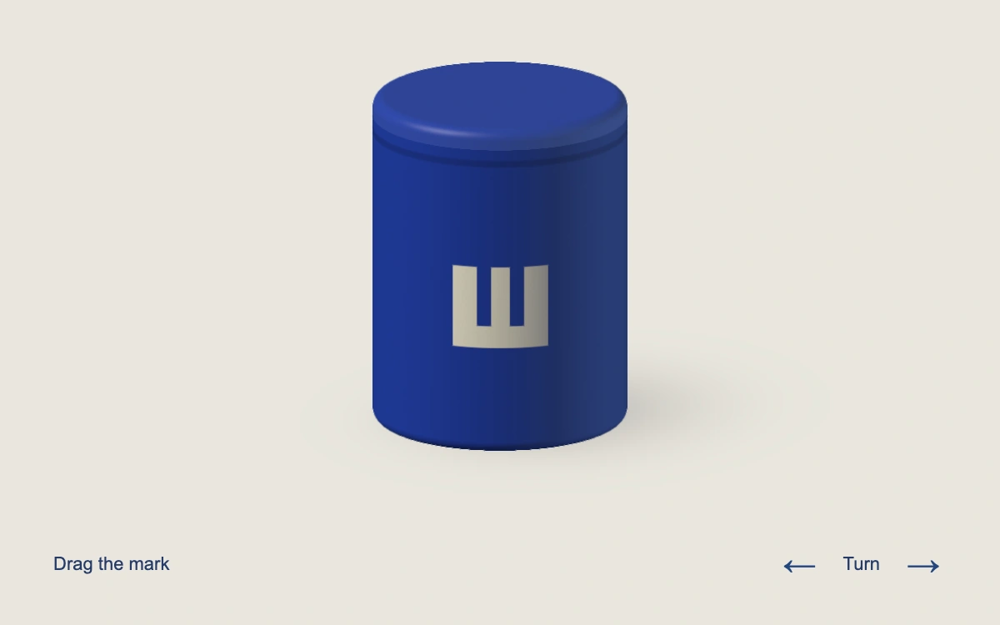

# Wrap a mark

> A cream geometric mark follows an unbranded cobalt canister as its surface placement changes and the vessel turns.

- **Common name:** Curved-surface graphic placement shader
- **Category:** WebGL & shaders
- **Live demo:** https://www.subframe.com/motion/wrap-a-mark
- **Source:** Subframe (original, MIT)
- **Dependencies:** none

## Use case

Explore one packaging mark's placement without opening a full branding editor.

## Interaction

Drag directly on the canister, use arrow keys to place the mark, and turn the vessel to inspect its side.

## Look

A matte cobalt canister with a quiet lid seam and cream geometric mark on warm stone; a red placement pin appears only during drag.

## Motion

Pointer rays intersect the cylinder to update surface angle and height. The mark remains attached to those coordinates as Turn changes the viewing angle; back surfaces stay occluded.

## How to adapt

`DEFAULT_CONFIG` and the `config` prop expose mark scale, rotation and edge softness. `mark` defines the original graphic; `u_markAngle`/`u_markY` store surface placement, and `u_orbit` rotates the coordinate frame independently.

## Reduced motion

Placement and inspection turn update directly, with no settling or automatic orbit.

## Limitations

One procedural cylinder and original geometric mark. Placement is cylindrical surface-coordinate mapping, not a general projected-decal engine. No source assets, fonts or textures. WebGL 1 with original SVG fallback and context restoration.

## Taxonomy

- **Components:** scene, button
- **Triggers:** drag, keyboard, press
- **Techniques:** shader, 3d, rotate
- **Feel:** refined, technical
- **Contexts:** landing, editorial
- **Tags:** decal, packaging, mark, cylinder, UV, placement, native webgl
- **Also known as:** cylinder decal, package personalization, curved logo placement, surface UV drag
- **Surface color:** `#e9e6dd`

## Code

See [`component.tsx`](component.tsx).
